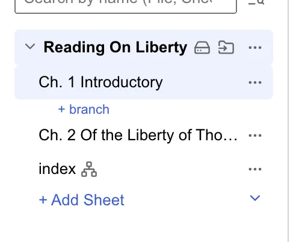
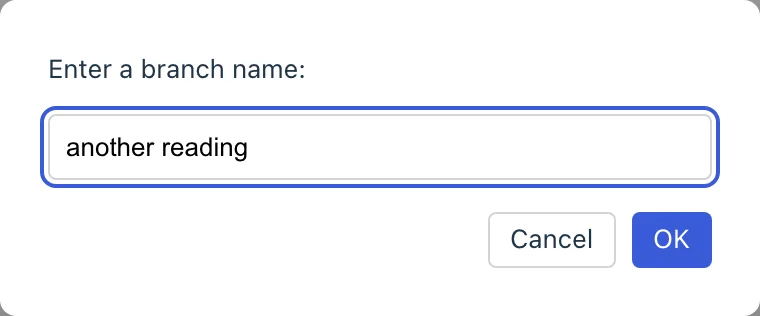
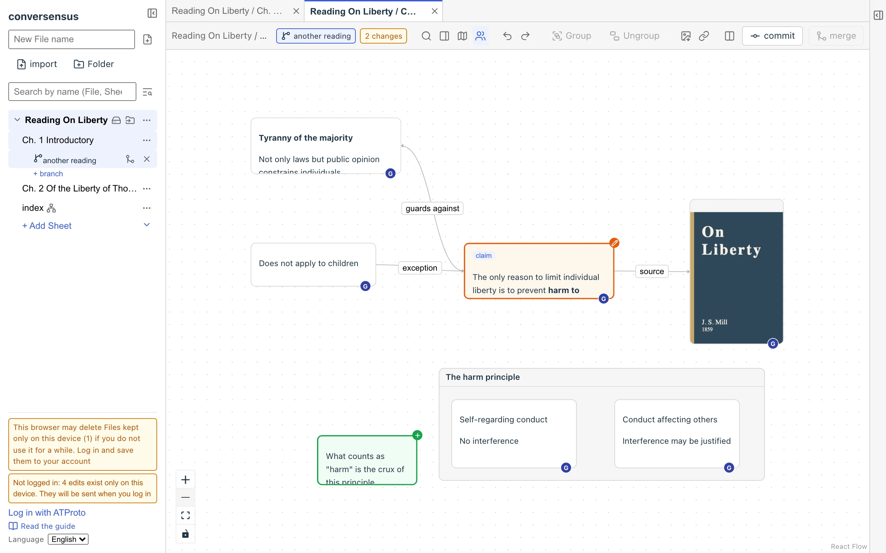
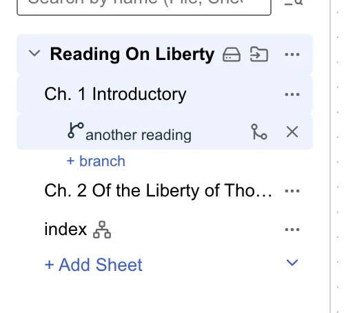
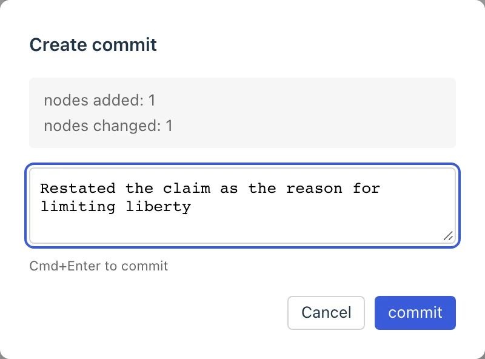
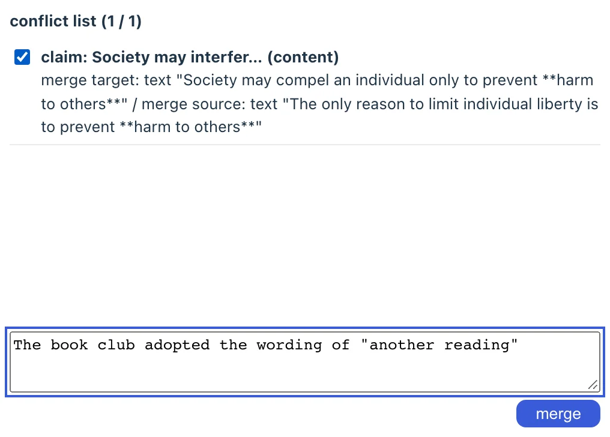
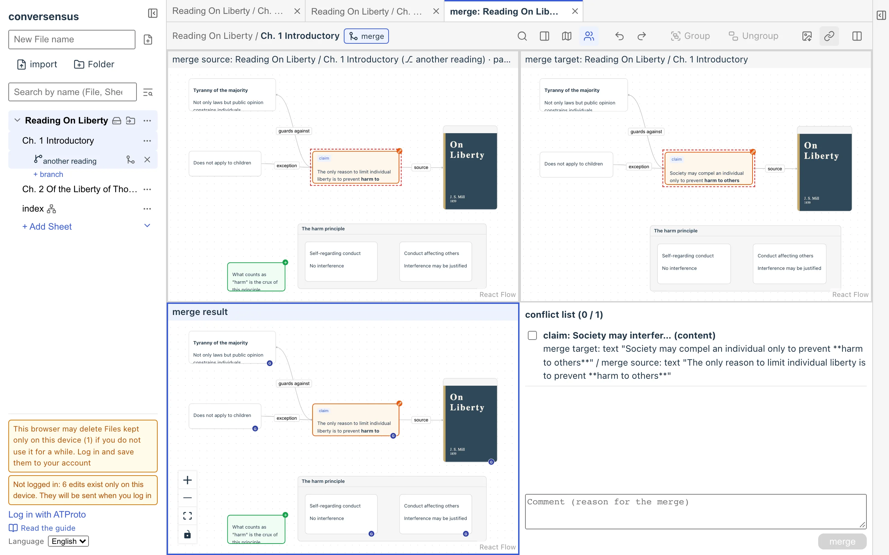
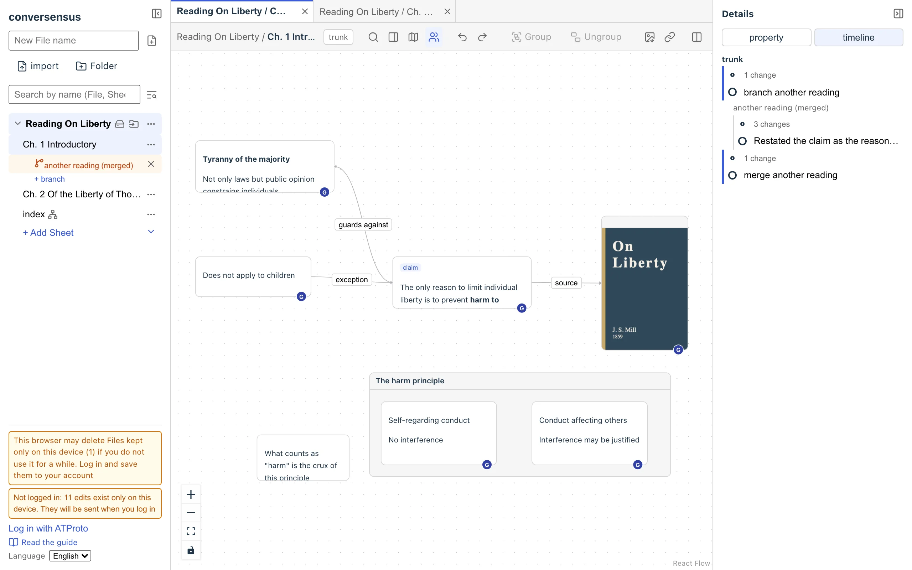

# Evolving graphs

A conversensus graph expresses things (nodes) and the relations between them (edges). Even so, what it shows is only one "moment" (the present) of that graph.

Most graphs start with one or a few nodes and grow little by little. conversensus records the whole process of a graph's changes.

And growth does not always go in a straight line: back and forth, trying things, starting over. conversensus can keep several versions of one graph.

They form a tree whose nodes are the versions of a graph and whose edges are the update relations between them. conversensus calls this the version tree.

In conversensus, not only the current graph but also how the graph grew and its several versions matter just as much.

## trunk

The "official" or "latest" version of a graph. There is exactly one per graph. The Sheet itself represents the trunk.

<figure>
	
	<figcaption>trunk</figcaption>
</figure>

## branch

A version that branches off from the trunk, or the act of making such a branch. You can make branches at any time, as many as you like. A branch branches off from the trunk as it is at that moment (its latest state). You cannot make a branch from a past point of the trunk.

You make a branch with the button on the Sheet's row in the left sidebar ("+ branch").

You can give a branch a name. A name that tells why you made the branch is a good idea. You can change it later, so do not think too hard about it.

<figure>
	
	<figcaption>Creating a branch</figcaption>
</figure>

When you change a branch, the changes accumulate in the branch. The branch's graph shows the differences since the last commit (see the next section).

<figure>
	
	<figcaption>Piling up changes on a branch</figcaption>
</figure>

When you close a branch, it can no longer be changed. When you delete a branch, it is no longer shown in the left sidebar.

<figure>
	
	<figcaption>Closing/deleting a branch</figcaption>
</figure>

## commit

A commit is a mark that closes off a set of changes to a branch. Each commit records its reason.

<figure>
	
	<figcaption>commit</figcaption>
</figure>

After committing a branch, you can keep piling up changes on it.

## merge

To merge a branch is to take the commits of the branch into the trunk. If the branch has changes not yet committed, it cannot be merged.

<figure>
	
	<figcaption>merge</figcaption>
</figure>

You merge with "merge" in the header (or "merge into trunk" on the branch's row in the left sidebar). If there are no conflicts, you only write the reason for the merge, and the branch's changes are taken into the trunk.

However, if the trunk has also changed after the branch was made, the branch's changes and the trunk's changes may conflict (different changes to the same part). conversensus handles conflicts in three kinds.

- Content conflicts

  Both sides rewrote the content or properties of the same node or edge differently. A person has to decide which to take

- Structure conflicts

  An operation on one side breaks what the other side assumes. For example, one side deleted a node that the other side connected an edge to

- Position/size conflicts

  Both sides changed the position or size of the same node differently. The later one wins, and no human decision is asked for

If there are content or structure conflicts, the merger screen opens before the merge.

The merger shows the merge source (the branch, as it was when opened) and the merge target (the trunk) at the top, and the merge result and the conflict list at the bottom. The merge source and target are for viewing only; only the merge result can be edited. Right-click an element in the merge source or target and choose "Take into the merge result", and the merge result takes on that element's state.

Check every conflict in the conflict list and mark it, write the reason for the merge, and press "merge"; the merge result is then taken into the trunk.

<figure>
	
	<figcaption>Resolving conflicts</figcaption>
</figure>

The branch lives on after the merge; you can keep piling up changes and commits, and merge again if needed.

## history

Every change to a graph is recorded. Open the timeline in the right sidebar to see the graph's history.

The timeline shows the version tree, where you can see how the trunk and branches split, and their commits and merges. Below it, the changes are listed in groups (batches); open one to see who did what when, and the nodes/edges involved.

Press "Open the graph at that point" to show the graph at a past point in a tab. A graph at a past point is read-only and cannot be edited.

With "Copy link to this view" in the header, you can copy a link to the graph you are looking at (a Sheet or a branch) to the OS clipboard. Opening the link shows that graph in conversensus.

<figure>
	
	<figcaption>An example of the timeline pane</figcaption>
</figure>

---

## What is here

- trunk
- branch
- commit
- merge
- version tree
- timeline

## What you can do here

- trunk
  - make a branch (from the trunk at that point)
- branch
  - change
  - commit
  - merge into the trunk
  - close
  - delete
- merge
  - check the differences from the trunk
  - write the reason for the merge
  - decide conflicts put on hold in the merger
- history
  - see the version tree
  - see the history of changes
  - open the graph at a past point (read-only)
  - copy a link to the graph you are looking at
