# Graph kata

conversensus provides several predefined kinds of graphs and nodes. You can put them to use in describing your graphs.

More may be added in the future, as standard features of conversensus or by installing extensions.

Here we introduce some of the ones available now.

## metagraph

A metagraph is a graph whose nodes are graphs (actually, the Sheets on which graphs are drawn). Because it is a graph about graphs, we call it a metagraph.

When you create a new File, a metagraph named index is created as a special Sheet. Each time you add a Sheet to the File, a node for that Sheet (called a graph node) is added to index, and when you delete a Sheet, its graph node is removed from index.

The reverse also holds. If you choose "Graph" when creating a node in index, a Sheet is added, and if you delete a graph node, its Sheet is deleted (after a confirmation dialog). If you rename a graph node, the Sheet is renamed too. In other words, the File's Sheets and the metagraph's graph nodes are kept in sync. index itself also appears in index as a graph node.

Graph nodes have the label `graph`, which tells them apart from ordinary nodes. This label cannot be changed.

<figure>
	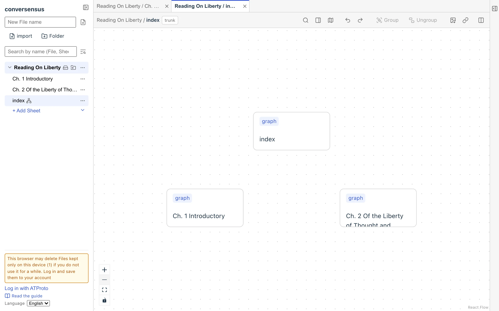
	<figcaption>The default index</figcaption>
</figure>

You can add any nodes (other than graph nodes) and edges to index. That is, you can describe the relations between the Sheets in this File, or leave comments.

Double-click a graph node to show its Sheet in a tab.

<figure>
	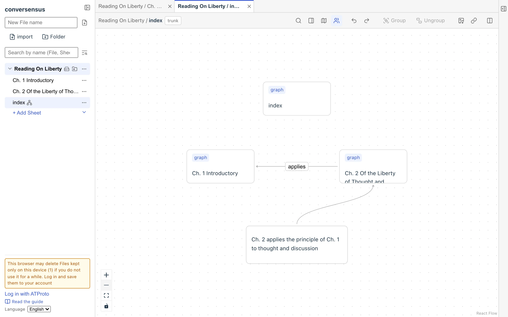
	<figcaption>index</figcaption>
</figure>

Besides the index created with the File, you can make your own metagraphs. Choose "+ metagraph" from the ▾ next to "+ Add Sheet" in the left sidebar.

This lets you express several different viewpoints on the relations between the Sheets in a File.

<figure>
	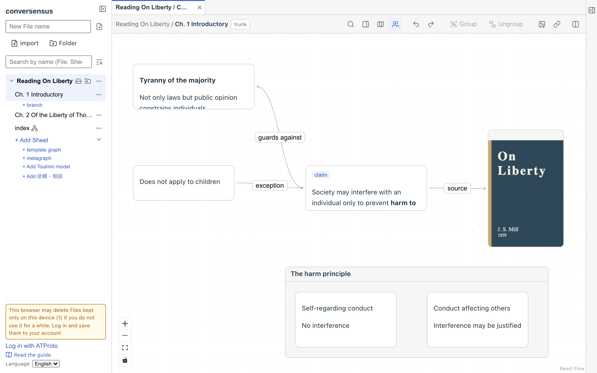
	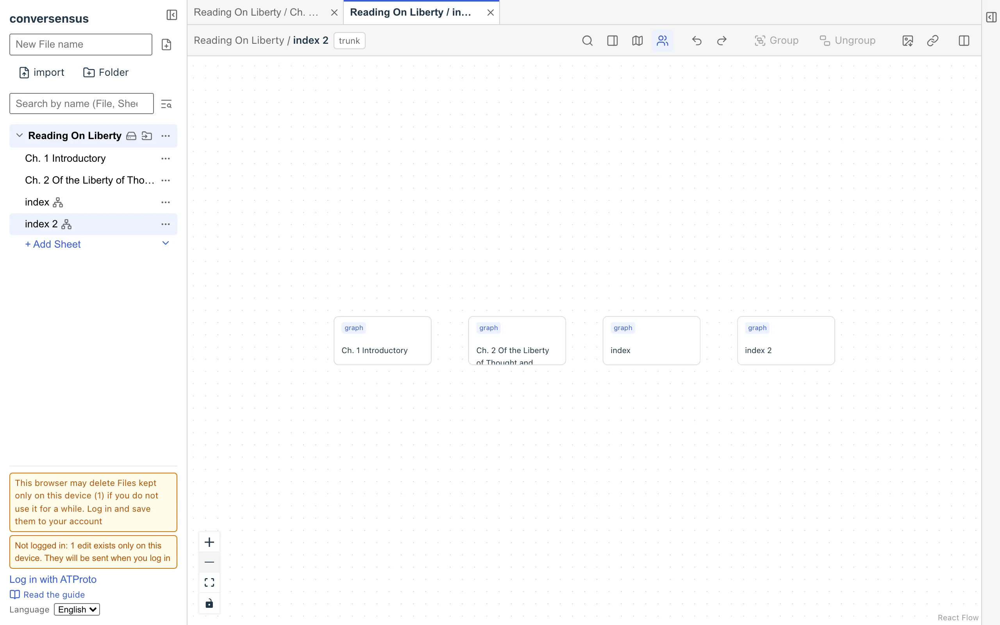
	<figcaption>metagraph</figcaption>
</figure>

## Toulmin model

Choose "+ Add Toulmin model" from the ▾ next to "+ Add Sheet" in the left sidebar, and a template graph of the Toulmin model is added to the File. If you then press "+ Add Sheet", you can choose the template graph to apply to the new Sheet; choose the Toulmin model, and you get a Sheet for drawing graphs based on the Toulmin model.

The Toulmin model is a base graph (schema) for logical argument and analysis of a problem, used for analyzing arguments (Toulmin is the name of the philosopher who proposed it).

<figure>
	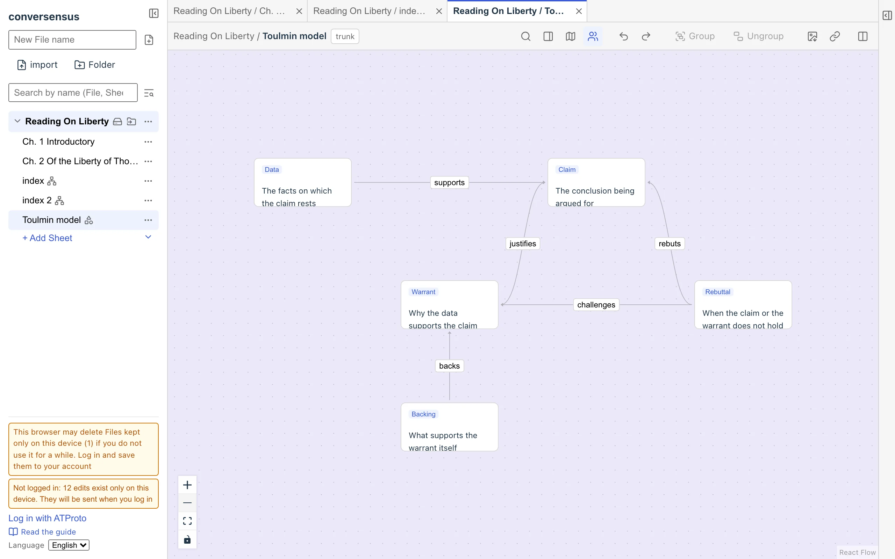
	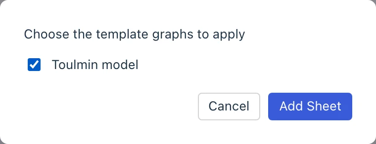
	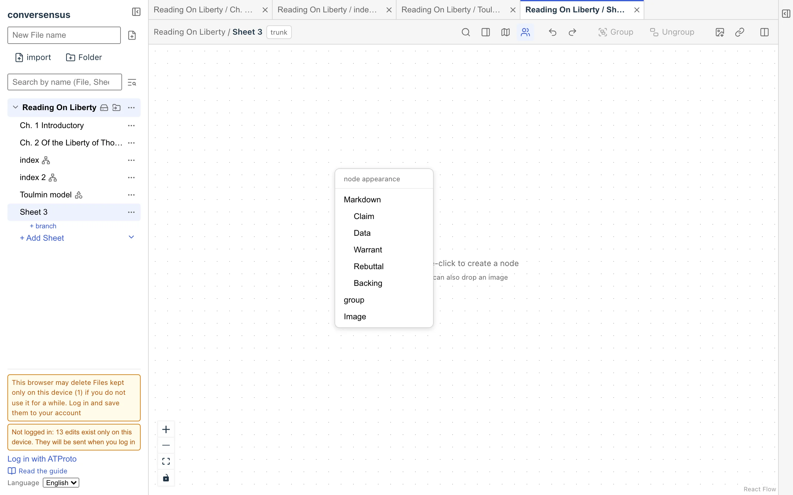
	<figcaption>The Toulmin model</figcaption>
</figure>

On a Toulmin model Sheet, you can create nodes that follow the schema above and connect them with edges that follow the schema. The labels of nodes that follow the schema (such as "Claim") are decided by the template and cannot be changed (labels are shown in the viewer's language; see "Keeping names per language" under "template graph"). You can also create any nodes outside the schema, label them freely, and connect them with edges.

For example, if you have a graph on some theme, and you carried out several arguments about it each in its own Toulmin model, it is a good idea to describe the relations between them on a metagraph.

Note also that conversensus provides the Toulmin model only as one example of use; it does not claim that this is the one approved way of arguing.

## template graph

A template graph defines the kinds of nodes that can be drawn on a graph, the kinds of edges determined by the kinds of nodes, the properties valid for them, and so on.

In fact, the Toulmin model is also defined with a template graph.

We will not go into details here, but if you look at the Toulmin model's template, you will see that the structure of the graph is defined in a straightforward way.

You can also make template graphs yourself. Choose "+ template graph" from the ▾ next to "+ Add Sheet", and draw a graph on the Sheet you made; it becomes the template as it is. Nodes with a label become kinds of nodes, and nodes without a label become explanatory notes.

### Writing kinds

What you draw in a template graph works as follows in the Sheets it is applied to.

- **Node appearance**: the appearance of a kind's node (Markdown, group, Image) becomes the appearance of that kind. In the menu for creating a node in an applied Sheet, the kinds of each appearance are listed, indented, just below that appearance. For example, if you give a group node the label "Discussion", choosing "Discussion" creates a group node
- **Shared names**: if two kinds have the same label, neither can be used (they do not appear in the menus of applied Sheets). A warning appears at the top of the template graph; change one of the labels
- **Edge kinds**: the label of an edge between kind nodes becomes an edge kind. When you connect nodes of that pair in an applied Sheet, the label is attached automatically if exactly one kind fits, and you choose from a menu if several fit
- **Edges to "any node"**: an edge between a kind node and a node without a label becomes the kind "an edge that can be drawn from (to) that kind to any node". But that it can be drawn does not mean it must be, so this kind is never attached automatically. A menu appears when you connect, and you can choose that kind or "Connect without a label"
- **Properties**: properties written on a kind's node / edge appear on the elements of that kind in applied Sheets. The value you write is the property's default; it is shown faintly in the property panel of the applied Sheet (writing a value replaces it). The panel adds the template's name to the property's name
  - In the property panel of a template graph, each row has a "type" field. You can write `string`, `number`, `boolean`, `date`, `datetime`, arrays of them (`string[]` and so on), and choices (`'high' | 'mid' | 'low'`). A trailing `?` (`date?`) makes a property that may have no value. With a type, applied Sheets mark values that do not match the type and required properties with no value (they are only marked; the values stay as they are). A property with choices is entered by choosing
  - Unchecking "Editable where applied" makes the property always have the template's value in applied Sheets, and it cannot be changed (not by agents either)
  - The name `kind` cannot be used (it would collide with the property that holds the kind)
- **Body**: the body written in a Markdown kind's node is shown faintly in nodes of that kind created in an applied Sheet, while their body is empty. Use it as a hint for what to write, such as "State the conclusion in one sentence". It disappears once you write a body

<figure>
	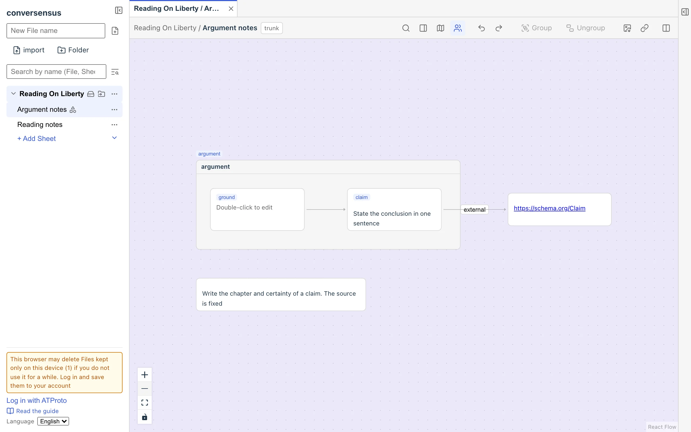
	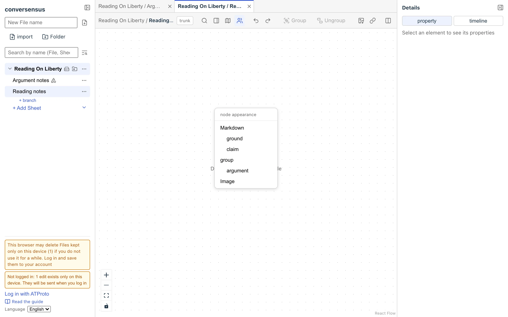
	<figcaption>A hand-written template graph, and the kind menu of a Sheet it is applied to</figcaption>
</figure>

<figure>
	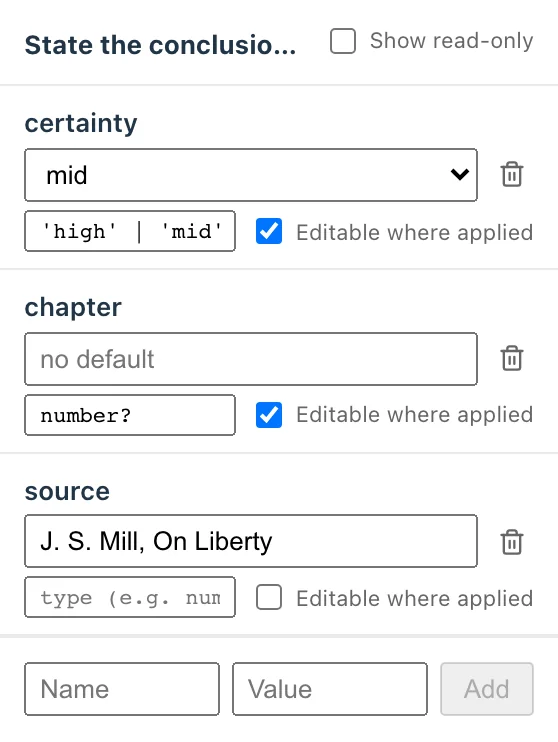
	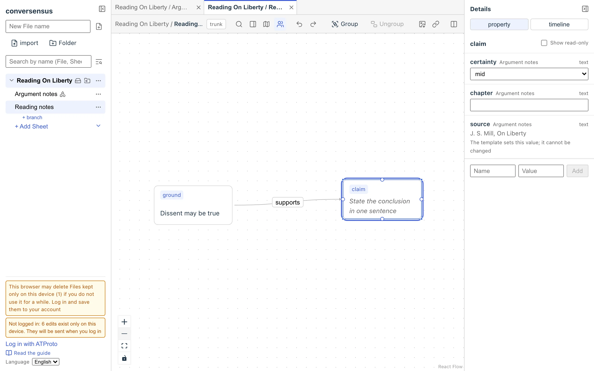
	<figcaption>Declaring properties in a template graph, and how they look in an applied Sheet</figcaption>
</figure>

Drawing kinds inside a group does not mean that those kinds can only be used inside a group. conversensus does not treat a group as a scope, so in an applied Sheet they can be placed anywhere. But if the template's author wrote them inside a group as a unit, it is good to respect that intent and write them inside a group in the applied Sheet too. In other words, groups in a template graph are a loose guideline.

#### Connecting to existing ontologies

To relate a kind to a concept of an existing ontology (vocabulary), place a node without a label in the template graph, write the concept's URI in its body, draw an edge from the kind's node to it, and give the edge a conventional label such as `external` or `import`. This is an edge to "any node" as above, so it does not get in the way of connecting freely in applied Sheets.

### Applying a template afterwards

You can apply a template not only when you create a Sheet but also later, to a Sheet that already exists. Choose "Apply template" from the "…" of the Sheet, choose the template graph you want, and press "Apply" (it cannot be pressed until you choose one). From then on, the kinds of that template are added to the kind menu when you create a node in that Sheet.

<figure>
	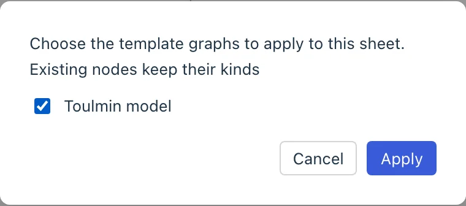
	<figcaption>Applying a template to an existing Sheet</figcaption>
</figure>

- The kinds of nodes already in that Sheet do not change
- If you edit the template graph after applying it, the Sheet keeps the version it had when you applied it. To use a newer version, see "Growing a template" below
- "Apply template" is not shown when the File has no template graph to apply (those already applied are excluded), or when the Sheet is itself a template graph

### Growing a template

A template does not have to be complete from the start. As you draw graphs, add the patterns that appear to the template graph, and the template grows.

When you change the template graph so that its kinds change as seen from an applied Sheet (kinds added, removed or renamed, the pair of an edge's ends, properties, the body), the "Template versions" area at the bottom right of the screen shows `"<template graph>" applied to "<Sheet>" has a newer version`. Only moving nodes, or only adding nodes without a label (notes), does not show it.

<figure>
	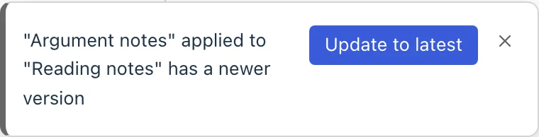
	<figcaption>The notice of a newer version</figcaption>
</figure>

- Pressing "Update to latest" makes the Sheet use the current version of the template graph. The "…" of the Sheet also shows `Update "<template graph>" to the latest version`, only while there is a newer version
- A notice closed with × does not appear again until the template graph changes further
- After updating, the kind names of existing elements are shown with the new names
- Elements that no longer follow the rules of the new version stay, neither deleted nor replaced, and are marked. An edge whose kind is gone, or whose pair of ends is no longer allowed, becomes a dashed line in the warning color; hover over the line or its label to see why. A property that no longer matches its type is marked in the property panel
- If you delete the template graph's Sheet, the notice says `"…" was deleted. The Sheet keeps working with the applied version`. Applied Sheets keep using the kinds of the version they had
- Notices appear only for the File you have open. When working together, once someone updates to the latest version, the notice disappears for the other participants too
- Agents do not update to the latest version. Moving a template's version is a decision that affects the whole Sheet, so people make it

<figure>
	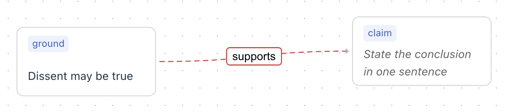
	<figcaption>An edge whose kind is gone is not deleted; it becomes a dashed line in the warning color</figcaption>
</figure>

### Detaching an applied template

A template applied afterwards can be detached with `Detach "<template graph>"` in the "…" of the Sheet. Detaching removes that template's kinds from the kind menu. Nodes and edges you already made are not deleted and keep their labels. You can apply a detached template again with "Apply template".

<figure>
	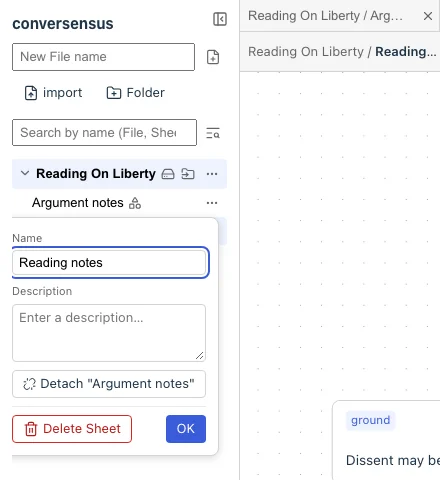
	<figcaption>Detaching a template applied afterwards</figcaption>
</figure>

**A template applied when the Sheet was created cannot be detached.** It is recorded in the creation of the Sheet itself and cannot be undone later (even after updating it to the latest version, no detach entry appears). If you want a Sheet without that template, make a new Sheet.

### Keeping names per language

The kinds (nodes and edges) of a template graph can have a name and a description for each language. Write them in the properties of the kind's node, such as `label:ja` = 主張 and `label:en` = Claim (descriptions are `description:ja` / `description:en`). In a Sheet that has the template applied, they are shown in the viewer's language. For example, a Toulmin model Sheet looks like "主張", "データ", "支える" to someone using Japanese, and "Claim", "Data", "supports" to someone using English. The kind menu works the same way.

- If there is no translation in the viewer's language, the name written in the template graph is shown as it is
- Only the display changes; what is stored does not
- A Toulmin model that was already in a File has no translations, so it stays in Japanese until you add the properties. One added with "+ Add Toulmin model" now has Japanese and English names
- When you change a kind's label in the template graph, the translation in your own language (`label:en` on an English screen) changes with it. Translations in other languages stay as they are, so ask someone using that language to retranslate them

---

## What is here

- metagraph
- Toulmin model
- template graph

## What you can do here

- metagraph
  - list the graphs in a File
  - add and delete graphs of the File from the graph
  - describe the relations between graphs in a File, and comments, as a graph
  - offer several viewpoints on the structure of the graphs in a File
- template graph
  - define, as a graph, a type of graph in which the kinds of nodes/edges and the relations between nodes are fixed in advance
  - create Sheets based on that type
  - decide, per kind, the node appearance, the default, type and editability of properties, and a hint for the body
  - apply a template afterwards to a Sheet that already exists, and detach one applied afterwards
  - add to the template graph while drawing, and update applied Sheets to the latest version (a notice tells you of a newer version)
  - keep the name and description of each kind per language (shown in the viewer's language)
  - connect to concepts of existing ontologies
  - make a template graph that extends or changes an existing one
- Toulmin model
  - serves as a sample template graph
  - use it as a type of graph for argument and argument analysis
  - customize it into an argument graph for your own purposes
