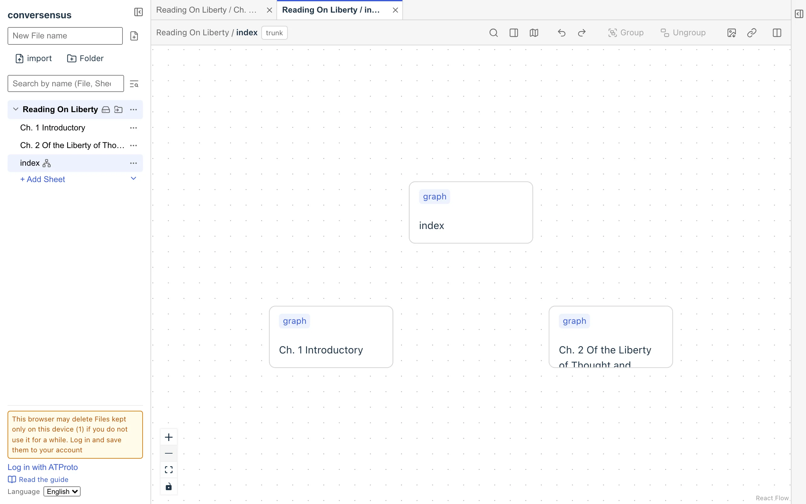
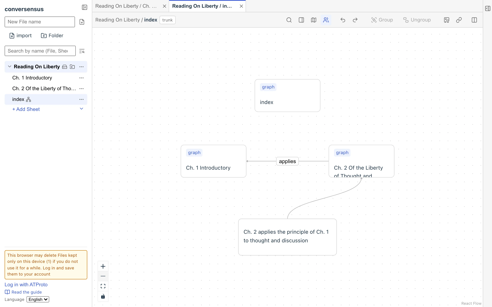
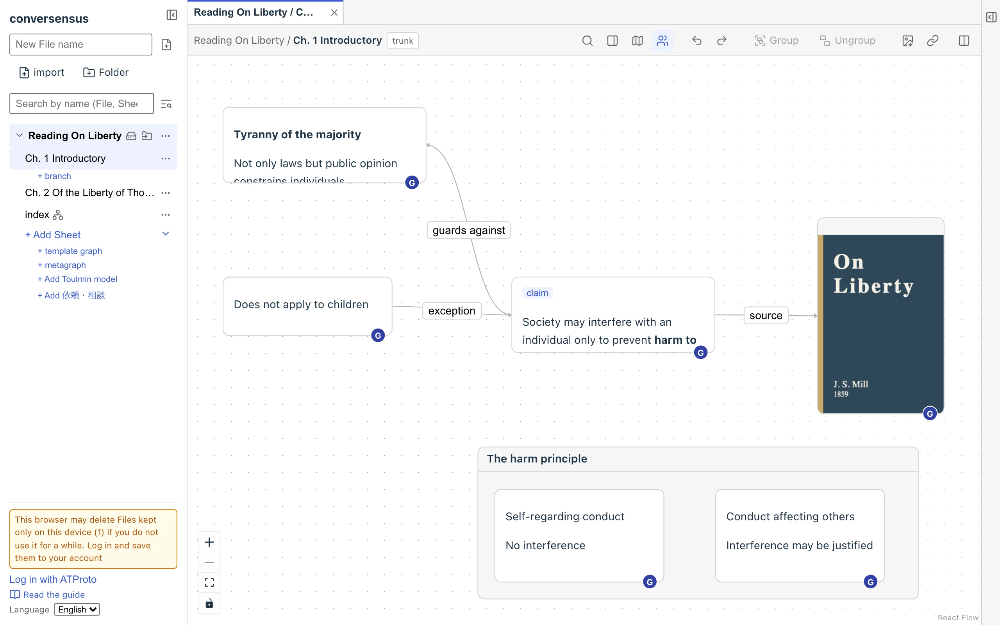
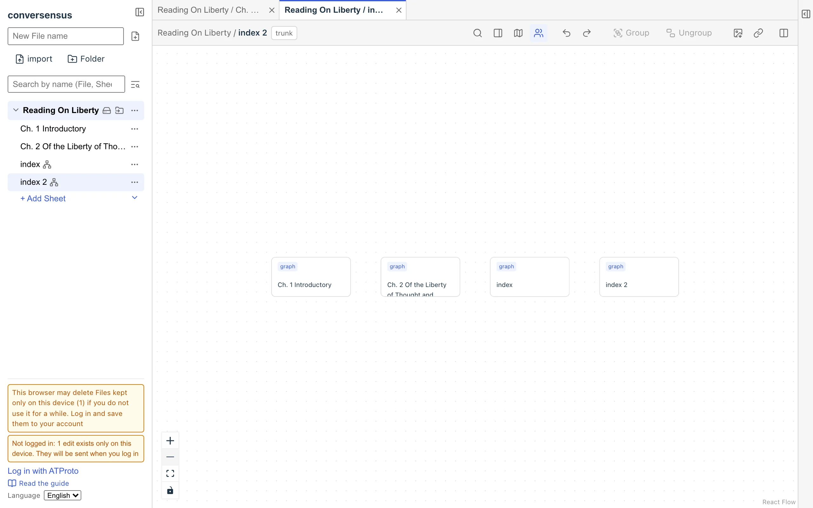
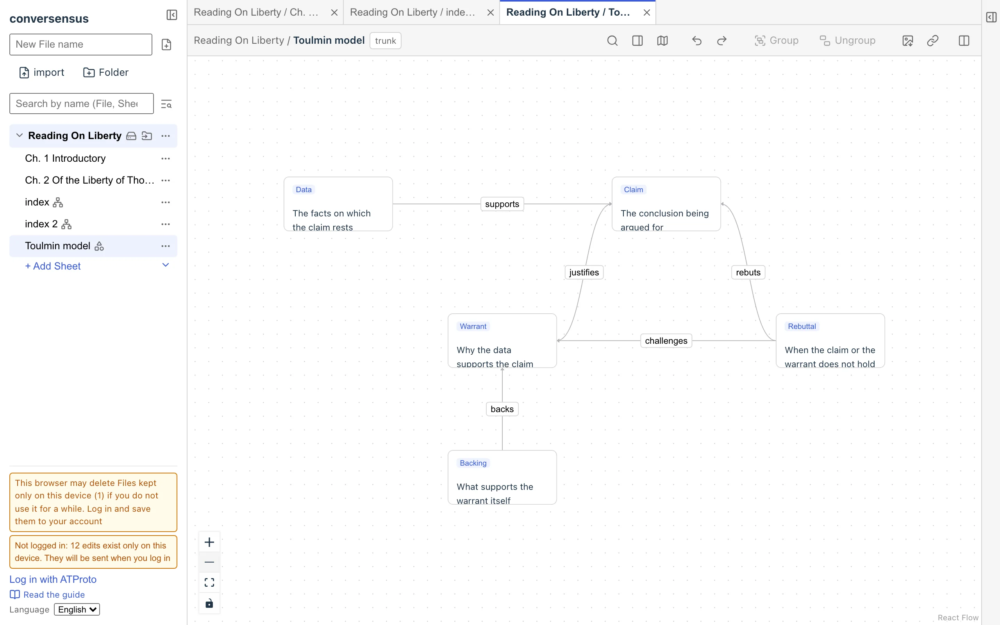
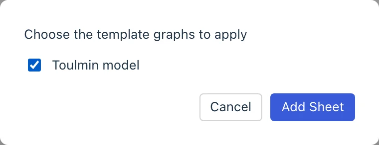
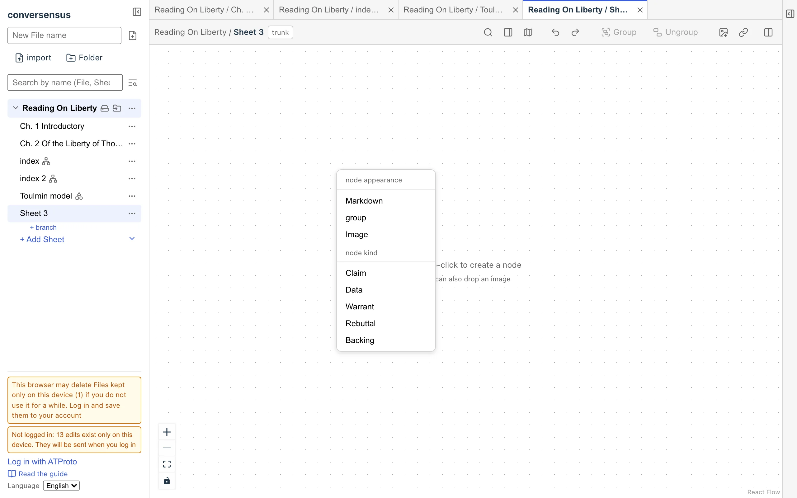
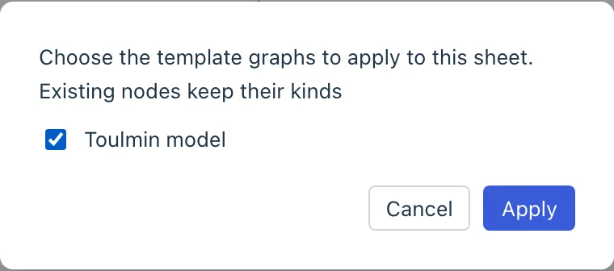

# Graph kata

conversensus provides several predefined kinds of graphs and nodes. You can put them to use in describing your graphs.

More may be added in the future, as standard features of conversensus or by installing extensions.

Here we introduce some of the ones available now.

## metagraph

A metagraph is a graph whose nodes are graphs (actually, the Sheets on which graphs are drawn). Because it is a graph about graphs, we call it a metagraph.

When you create a new File, a metagraph named index is created as a special Sheet. Each time you add a Sheet to the File, a node for that Sheet (called a graph node) is added to index, and when you delete a Sheet, its graph node is removed from index.

The reverse also holds. If you choose "Graph" when creating a node in index, a Sheet is added, and if you delete a graph node, its Sheet is deleted (after a confirmation dialog). If you rename a graph node, the Sheet is renamed too. In other words, the File's Sheets and the metagraph's graph nodes are kept in sync. index itself also appears in index as a graph node.

Graph nodes have the label `graph`, which tells them apart from ordinary nodes. This label cannot be changed.

<figure>
	
	<figcaption>The default index</figcaption>
</figure>

You can add any nodes (other than graph nodes) and edges to index. That is, you can describe the relations between the Sheets in this File, or leave comments.

Double-click a graph node to show its Sheet in a tab.

<figure>
	
	<figcaption>index</figcaption>
</figure>

Besides the index created with the File, you can make your own metagraphs. Choose "+ metagraph" from the ▾ next to "+ Add Sheet" in the left sidebar.

This lets you express several different viewpoints on the relations between the Sheets in a File.

<figure>
	
	
	<figcaption>metagraph</figcaption>
</figure>

## Toulmin model

Choose "+ Add Toulmin model" from the ▾ next to "+ Add Sheet" in the left sidebar, and a template graph of the Toulmin model is added to the File. If you then press "+ Add Sheet", you can choose the template graph to apply to the new Sheet; choose the Toulmin model, and you get a Sheet for drawing graphs based on the Toulmin model.

The Toulmin model is a base graph (schema) for logical argument and analysis of a problem, used for analyzing arguments (Toulmin is the name of the philosopher who proposed it).

<figure>
	
	
	
	<figcaption>The Toulmin model</figcaption>
</figure>

On a Toulmin model Sheet, you can create nodes that follow the schema above and connect them with edges that follow the schema. The labels of nodes that follow the schema (such as "Claim") are decided by the template and cannot be changed (labels are shown in the viewer's language; see "Keeping names per language" under "template graph"). You can also create any nodes outside the schema, label them freely, and connect them with edges.

For example, if you have a graph on some theme, and you carried out several arguments about it each in its own Toulmin model, it is a good idea to describe the relations between them on a metagraph.

Note also that conversensus provides the Toulmin model only as one example of use; it does not claim that this is the one approved way of arguing.

## template graph

A template graph defines the kinds of nodes that can be drawn on a graph, the kinds of edges determined by the kinds of nodes, the properties valid for them, and so on.

In fact, the Toulmin model is also defined with a template graph.

We will not go into details here, but if you look at the Toulmin model's template, you will see that the structure of the graph is defined in a straightforward way.

You can also make template graphs yourself. Choose "+ template graph" from the ▾ next to "+ Add Sheet", and draw a graph on the Sheet you made; it becomes the template as it is. Nodes with a label become kinds of nodes, and nodes without a label become explanatory notes.

### Applying a template afterwards

You can apply a template not only when you create a Sheet but also later, to a Sheet that already exists. Choose "Apply template" from the "…" of the Sheet, choose the template graph you want, and press "Apply" (it cannot be pressed until you choose one). From then on, the kinds of that template are added to the kind menu when you create a node in that Sheet.

<figure>
	
	<figcaption>Applying a template to an existing Sheet</figcaption>
</figure>

- The kinds of nodes already in that Sheet do not change
- If you edit the template graph after applying it, the Sheet keeps the template as it was when you applied it
- There is no way yet to remove an applied template
- "Apply template" is not shown when the File has no template graph to apply (those already applied are excluded), or when the Sheet is itself a template graph

### Keeping names per language

The kinds (nodes and edges) of a template graph can have a name and a description for each language. Write them in the properties of the kind's node, such as `label:ja` = 主張 and `label:en` = Claim (descriptions are `description:ja` / `description:en`). In a Sheet that has the template applied, they are shown in the viewer's language. For example, a Toulmin model Sheet looks like "主張", "データ", "支える" to someone using Japanese, and "Claim", "Data", "supports" to someone using English. The kind menu works the same way.

- If there is no translation in the viewer's language, the name written in the template graph is shown as it is
- Only the display changes; what is stored does not
- A Toulmin model that was already in a File has no translations, so it stays in Japanese until you add the properties. One added with "+ Add Toulmin model" now has Japanese and English names

---

## What is here

- metagraph
- Toulmin model
- template graph

## What you can do here

- metagraph
  - list the graphs in a File
  - add and delete graphs of the File from the graph
  - describe the relations between graphs in a File, and comments, as a graph
  - offer several viewpoints on the structure of the graphs in a File
- template graph
  - define, as a graph, a type of graph in which the kinds of nodes/edges and the relations between nodes are fixed in advance
  - create Sheets based on that type
  - apply a template afterwards to a Sheet that already exists
  - keep the name and description of each kind per language (shown in the viewer's language)
  - make a template graph that extends or changes an existing one
- Toulmin model
  - serves as a sample template graph
  - use it as a type of graph for argument and argument analysis
  - customize it into an argument graph for your own purposes
