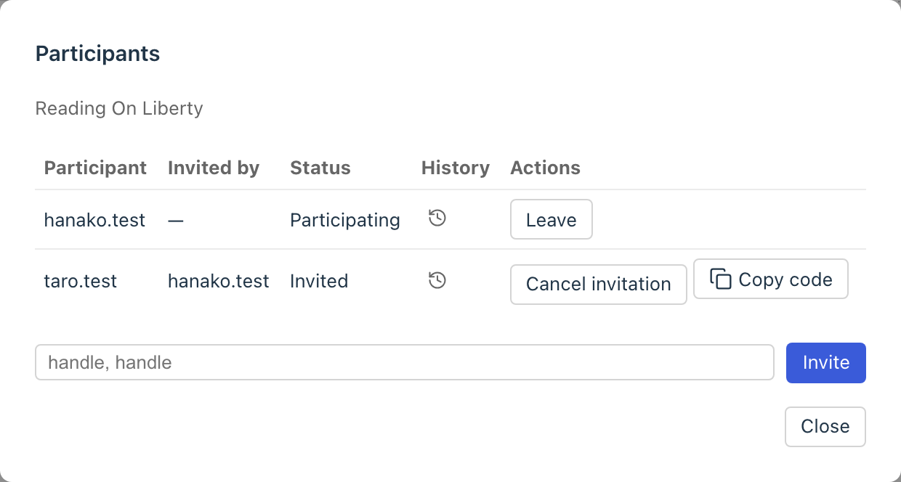
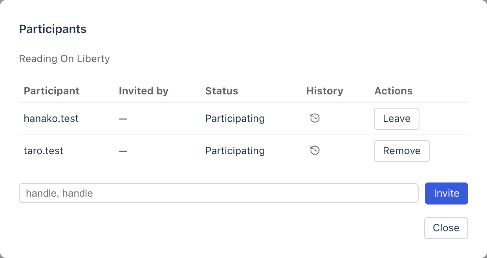
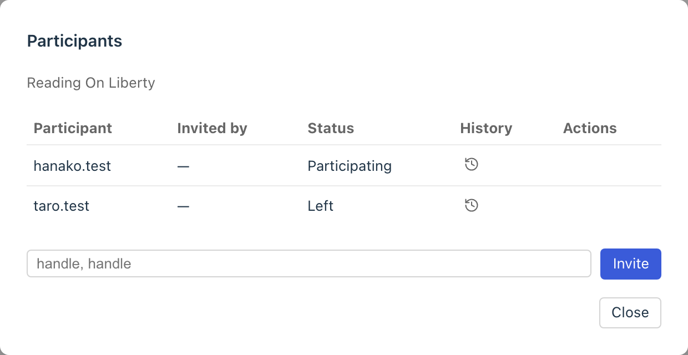

# Interacting through graphs

In conversensus, you can invite other accounts to edit a File, and grow a graph together with them.

You can invite people who have an ATProto account. For now, however, they need an account on the same PDS as the person who invites them.

## Inviting

Open the File's participants list, enter the handle of the person you want to invite, and press "Invite". You can enter several handles separated by commas.

<figure>
	
	<figcaption>Inviting</figcaption>
</figure>

An invitation issues a participation code. Copy it and give it to the other person outside conversensus (by email, chat, and so on).

## Joining

The person who received the participation code pastes it into "Join with a participation code". It shows who invites you to which File; check it and press "Join" to join in editing the File.

<figure>
	
	<figcaption>Joining</figcaption>
</figure>

The participants list shows who is participating (Invited, Participating, Left), and who took part in editing the File from when to when (the participation history).

<figure>
	
	<figcaption>The participants list</figcaption>
</figure>

## Editing together

While participating in editing a File, a person can do every operation on that File in the same way. Who did each operation is all kept in the history.

<figure>
	
	<figcaption>A history involving several members</figcaption>
</figure>

Edits by other participants reach your screen almost in real time. While the edits made during a period you were away (for example, while conversensus was not open) are being taken in, the File is read-only. Once that finishes, you can edit again.

### Conflicts

When several people edit the same place at the same time, conflicts can occur. As with merging in "Evolving graphs", conversensus handles conflicts in three kinds: content, structure, and position/size.

Conflicts are reported with a notice on the screen.

- For position or size conflicts, the later edit wins. The notice only reports the result and does not start a conversation
- Content and structure conflicts need a human decision about which to take. You do not have to decide on the spot: they can be recorded as "on hold" and decided later in the merger through conversation. Conflicts found and put on hold on the other person's side also arrive on your screen

When something you wrote has been changed by someone else's edit, an "overwrite report" is shown.

When a conflict occurs in a File open in another tab, that tab gets a mark.

<figure>
	
	<figcaption>A conflict notice</figcaption>
</figure>

## Leaving

A person can leave editing a File, and others can remove them ("Leave" / "Remove"). For now there is no systematized protocol for this. We recommend talking outside conversensus beforehand about accounts joining and leaving.

<figure>
	
	<figcaption>Leaving</figcaption>
</figure>

A File with no participants can be taken over by anyone with "Take over this File", who can then start editing it again.

---

## What is here

- actor (participant)
- invitation
- participation
- conflict

## What you can do here

- invitation
  - invite by entering handles
  - copy the participation code
  - cancel an invitation
- participation
  - join by entering a participation code
  - leave
  - see the participants list and the participation history
  - take over a File with no participants
- conflict
  - see conflict notices
  - decide conflicts put on hold later in the merger
  - see overwrite reports
