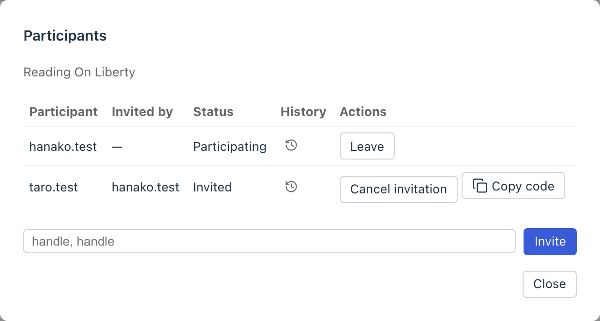
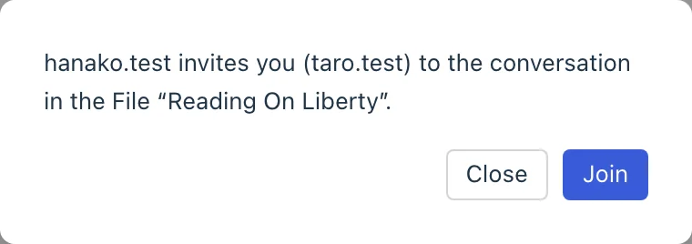
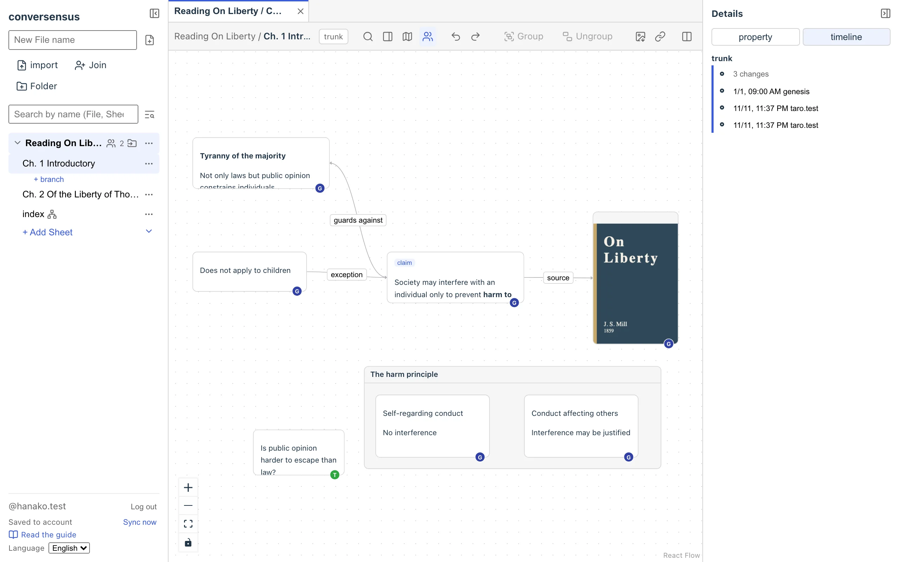
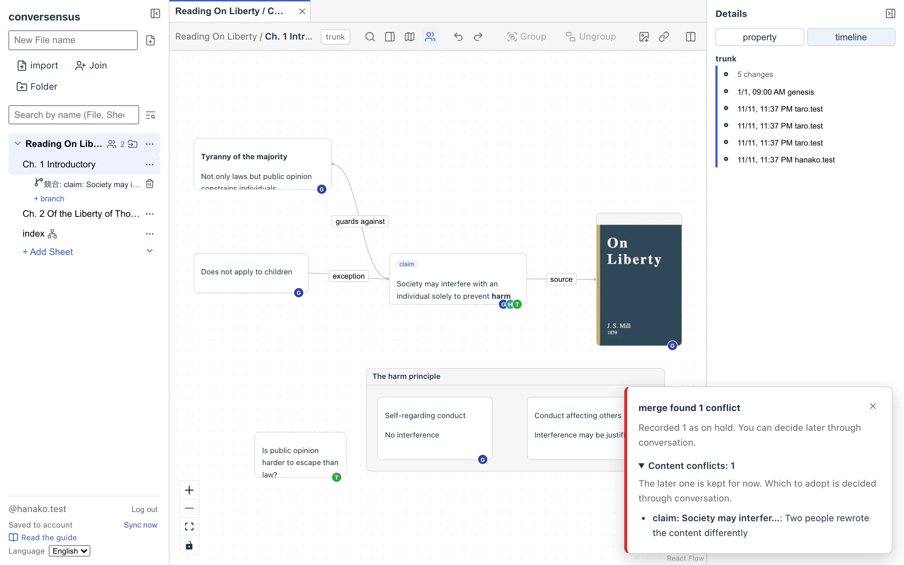
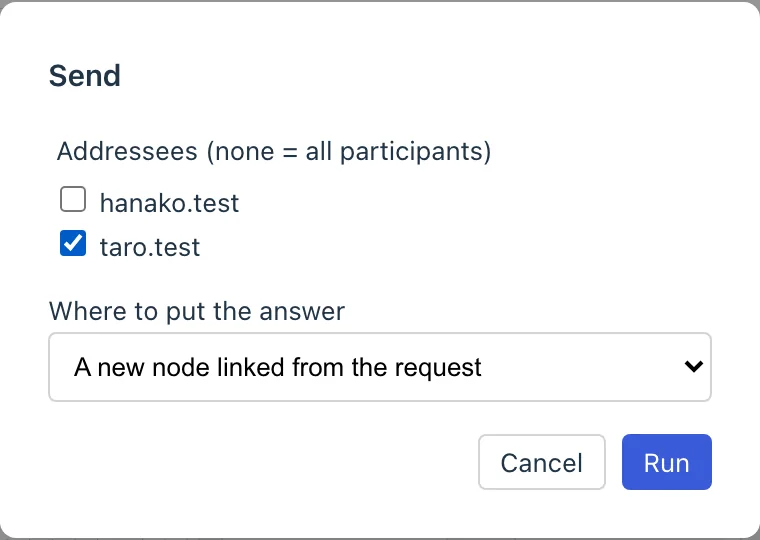
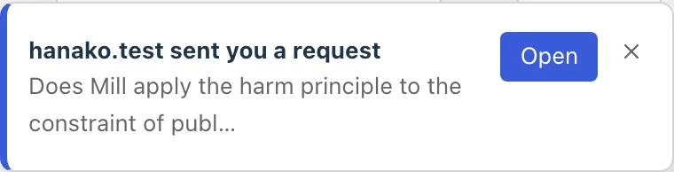
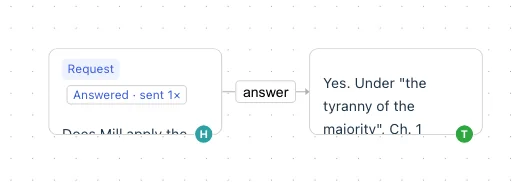

# Interacting through graphs

In conversensus, you can invite other accounts to edit a File, and grow a graph together with them.

You can invite people who have an ATProto account. For now, however, they need an account on the same PDS as the person who invites them.

## Inviting

Open the File's participants list, enter the handle of the person you want to invite, and press "Invite". You can enter several handles separated by commas.

<figure>
	
	<figcaption>Inviting</figcaption>
</figure>

An invitation issues a participation code. Copy it and give it to the other person outside conversensus (by email, chat, and so on).

## Joining

The person who received the participation code pastes it into "Join with a participation code". It shows who invites you to which File; check it and press "Join" to join in editing the File.

<figure>
	
	<figcaption>Joining</figcaption>
</figure>

The participants list shows who is participating (Invited, Participating, Left), and who took part in editing the File from when to when (the participation history).

<figure>
	
	<figcaption>The participants list</figcaption>
</figure>

## Editing together

While participating in editing a File, a person can do every operation on that File in the same way. Who did each operation is all kept in the history.

<figure>
	
	<figcaption>A history involving several members</figcaption>
</figure>

Edits by other participants reach your screen almost in real time. While the edits made during a period you were away (for example, while conversensus was not open) are being taken in, the File is read-only. Once that finishes, you can edit again.

### Conflicts

When several people edit the same place at the same time, conflicts can occur. As with merging in "Evolving graphs", conversensus handles conflicts in three kinds: content, structure, and position/size.

Conflicts are reported with a notice on the screen.

- For position or size conflicts, the later edit wins. The notice only reports the result and does not start a conversation
- Content and structure conflicts need a human decision about which to take. You do not have to decide on the spot: they can be recorded as "on hold" and decided later in the merger through conversation. Conflicts found and put on hold on the other person's side also arrive on your screen

When something you wrote has been changed by someone else's edit, an "overwrite report" is shown.

When a conflict occurs in a File open in another tab, that tab gets a mark.

<figure>
	
	<figcaption>A conflict notice</figcaption>
</figure>

## Together with agents

In conversensus, an agent (a participant that runs as a program rather than a person) can also take part in a File. An agent has its own account and reads and writes the File on the same footing as people. The steps for inviting one are the same as for a person. What an agent writes reaches the other participants' screens in the same way.

### Marks for agents

- The avatar of who wrote a node or edge is a circle with an initial for a person and a bot mark for an agent. Hover over it to see the handle and "agent"
- The agent's row in the participants list shows an "agent" mark and the agent's owner (the operator)

That something is an agent is something the agent declares about itself. When the operator has checked that it really is their own agent, they can press "Acknowledge as my agent" in the participants list, and the mark changes from "agent (self-declared)" to "agent (verified)". "Stop acknowledging" turns it back. The mark is only for display; what the agent can do does not change.

### Requests and consultations

Something you want someone (a person or an agent) to respond to can be sent as a "Request" or "Consultation" node (a request here is a different thing from the "invitation" described above). These are kinds in the template graph "Request / Consultation". When you create a Sheet (or apply it later to an existing Sheet) with that template, "Request" and "Consultation" appear in the node kind menu.

1. Create a "Request" node and write what you want to ask in its body
1. When you select the node, actions appear next to it (the right-click menu has the same ones). Press "Send" and choose the addressee from the participants
1. The addressee sees "(name) sent you a request" at the bottom right. Press "Open" and that request is selected
1. Press "Answer" and write the answer, and an answer node is connected to the right of the request and the request's mark becomes "Answered"

<figure>
	
	
	
	<figcaption>Sending, receiving, and answering a request</figcaption>
</figure>

The state of a request (unanswered, answered, and so on) is worked out from whether an answer node exists; it is not stored separately. A request can also be closed ("Close") or sent again ("Send again"). If you cannot answer, write the reason as your answer.

Notices of requests appear only for Files that are in sync (Files that are open or in a tab). A request to a File that is not open is unknown until you open it.

> [!NOTE]
> How to run an agent yourself will be described in a document for developers (not yet written).

## Leaving

A person can leave editing a File, and others can remove them ("Leave" / "Remove"). For now there is no systematized protocol for this. We recommend talking outside conversensus beforehand about accounts joining and leaving.

<figure>
	
	<figcaption>Leaving</figcaption>
</figure>

A File with no participants can be taken over by anyone with "Take over this File", who can then start editing it again.

---

## What is here

- actor (participant)
  - person
  - agent
- invitation
- participation
- conflict
- Request / Consultation

## What you can do here

- invitation
  - invite by entering handles
  - copy the participation code
  - cancel an invitation
- participation
  - join by entering a participation code
  - leave
  - see the participants list and the participation history
  - take over a File with no participants
- conflict
  - see conflict notices
  - decide conflicts put on hold later in the merger
  - see overwrite reports
- agent
  - see the marks for agents (avatars and the participants list)
  - as the operator, acknowledge an agent or stop acknowledging it
- Request / Consultation
  - create a request or consultation node and send it
  - answer a request that reached you
  - close a request or send it again
