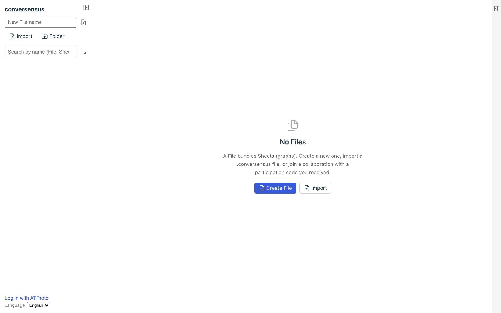

# Getting started

There are several ways to start using conversensus.

1. Use conversensus without an ATProto account
2. Use conversensus with an ATProto account
   1. Use the official conversensus PDS
   2. Use another PDS
      1. Use an account of another ATProto application
      2. Run your own PDS

> [!NOTE]
> **A little technical background**
>
> ATProto stands for Authenticated Transfer Protocol, and as the name says, it is an "authenticated" communication protocol. It was first developed for Bluesky, a decentralized social network, but many applications other than Bluesky use it now.
>
> ATProto has many components, but conversensus uses only the PDS (Personal Data Server), which provides:
>
> - registration and management of accounts
> - storage of data
>
> An account belongs to the one PDS where it was registered. When you log in to an ATProto application such as conversensus, you move to the page of the PDS that holds your account, log in there, and come back to the application. All the data you create with that account is stored on the PDS where the account was registered.

> [!WARNING]
> **Anyone can read the data stored on a PDS**
>
> Data stored on a PDS can be read by anyone, including people without an ATProto account. This is a property of ATProto itself. Do not write anything you would not want others to see in graphs you save to your account.

## Use conversensus without an ATProto account

You can use conversensus without an ATProto account. Just open `https://app.conversensus.site/` in a web browser.

You can draw graphs with conversensus without logging in to ATProto.

However, the graphs you make are stored only inside that web browser. In most cases the graphs are kept even after you quit the browser or close the window, but some browsers delete them after a while. When there is a risk of that, the screen shows a warning.

In a private browsing window, graphs cannot be saved (the screen says "Cannot save in this window").

You cannot reach those graphs from another device, or from another browser on the same device, but you can export a graph you drew as a file on that device and import it again, just as with an ordinary desktop application.

When you later log in with an ATProto account, you are asked whether to "Save to account" or "Keep on this device" the Files that exist only on this device. A File you kept on the device can be saved to your account later with "Save to account" in the File details.

## Use conversensus with an ATProto account

With an ATProto account, you can save your graphs to the PDS of that account and share them across any devices.

There are the following ways to get an ATProto account.

1. Get an account from another ATProto application such as Bluesky

   If you already have an ATProto account, you can use it. Note, however, that the data specific to conversensus, such as graphs, is then stored on the PDS where you got that account (for a Bluesky account, Bluesky's PDS)

2. Get an account from the official conversensus PDS (currently the only one)

   For now we run only a very small PDS. Registration there is by invitation and is not open to the public

3. Run your own PDS for conversensus

   You can run your own PDS and issue ATProto accounts. Running a small PDS is not that hard. Graphs drawn with these accounts are stored on that PDS

For now, in any of cases (1) to (3), you can collaborate only with people who have accounts on the same PDS. Collaboration with accounts on other PDSes is planned for the near future.

Whether or not you use an ATProto account, when you open https://app.conversensus.site/ in a web browser, you see a conversensus screen like this.

<figure>
	
	<figcaption>The initial screen of conversensus</figcaption>
</figure>
