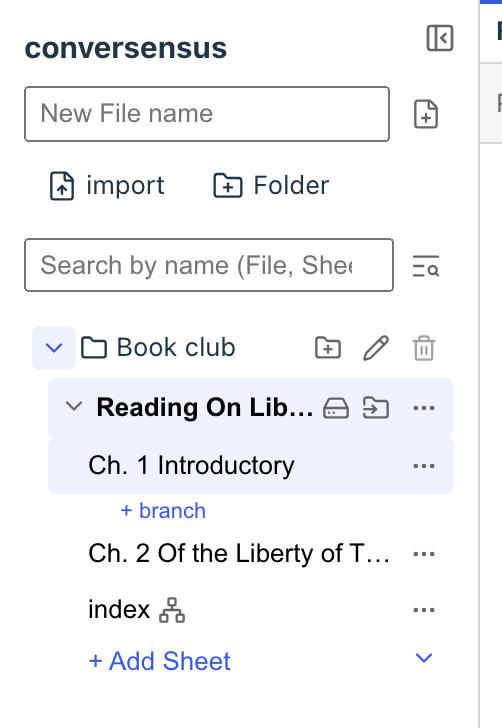

# Where graphs live

In conversensus, a single canvas on which you draw a graph is called a Sheet.

You can give a Sheet a name.

A collection of related Sheets is called a File.

You can give a File a name.

You can also organize Files by putting them in Folders.

Just like the file system of the OS you use (Linux, macOS, Windows, and so on), Folders can be named and nested, and you can move Files between Folders.

These are shown in the left sidebar on the left of the screen.

<figure>
	
	<figcaption>The left sidebar</figcaption>
</figure>

When you click a Sheet, the graph drawn on it is shown in a tab in the middle of the screen.

From the ▾ next to "+ Add Sheet", you can add special Sheets such as a metagraph or a template graph. If the File has template graphs, you can also choose which template graph to apply to the new Sheet when you use "+ Add Sheet" (see "Graph kata").

The search box in the left sidebar narrows the list by the names of Files, Sheets, and Folders. The search opened with ⌘⇧F (Ctrl+Shift+F on Windows and others) looks for names and node contents across Files. Neither searches descriptions.

Note that a Folder with contents cannot be deleted, and the last Sheet of a File cannot be deleted.

---

## What is here

- File
- Sheet
- Folder

## What you can do here

- File
  - create
  - delete
  - name/rename
  - write a description
  - export as a .conversensus file
  - import a .conversensus file
  - move to an existing Folder
- Sheet
  - create (optionally applying a template graph)
  - create special Sheets such as a metagraph or a template graph
  - delete (except the last Sheet)
  - name/rename
  - write a description
  - show the graph
- File/Sheet/Folder
  - narrow by name (left sidebar)
  - search names and node contents across Files (⌘⇧F)
- Folder
  - create
  - delete (empty Folders only)
  - name/rename
