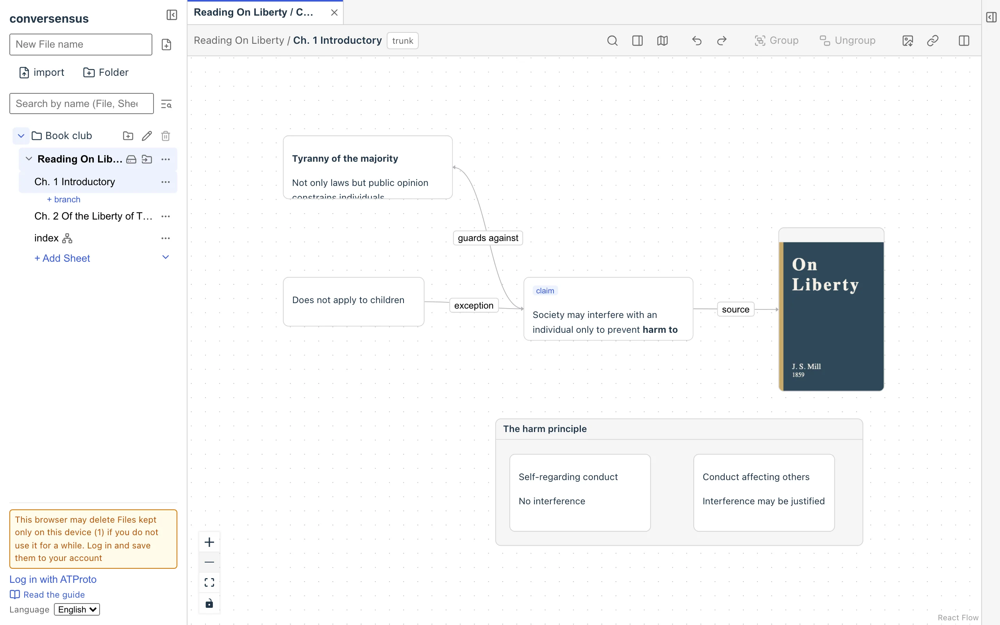
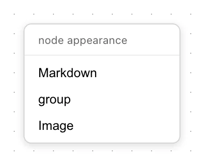
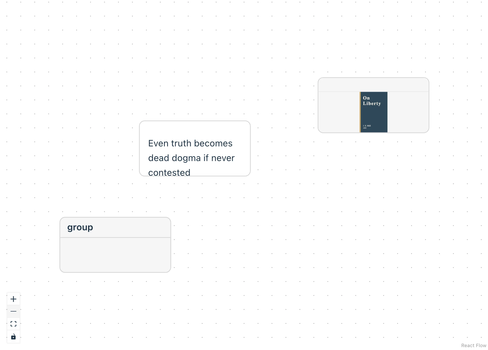

# Thinking with graphs

When you "think something over", it may come with linguistic acts such as looking/drawing, reading/writing, and listening/speaking.

Of course, there is also thinking and cognition without linguistic acts.

And sometimes it matters that bodily acts are involved.

Reading and writing graphs is one such linguistic act. And I think it may be a kind of linguistic act different from those that use natural language.

Depending on the particularities of a person's thinking and cognition, some people will find writing and reading graphs hard, or even reject it.

Conversely, some people who are not good at reading and writing natural language may find reading and writing graphs easier.

I, for one, sometimes feel the urge to rewrite everything as graphs while reading a book or talking with someone.

An ordinary book page leaves hardly any margin for that. And if you did that in an ordinary conversation, the conversation would stall, or you would fall behind.

conversensus is built with such "habits" of thinking and cognition in mind, to help the thinking and cognition of people who have them (mostly for myself, though).

Such "habits" may be innate, but they may also be formed socially in the course of development. If so, as society changes shape, people with various "habits" will become more or less common.

conversensus is one attempt to build tools that support such diverse "habits" of thinking and cognition.

## Doodling a graph

<figure>
	
	<figcaption>The graph screen</figcaption>
</figure>

When you have created a File in the place where graphs live and a Sheet in it is selected (a File contains one from the start), you can doodle a graph on the graph in the middle of the screen (it is empty at first).

### node

Double-click an empty part of the screen to create a node. You can create the following kinds of nodes.

- Markdown

  You can write any text. A simplified markdown is understood and shown formatted

- group

  Treats several nodes as one group. Drag nodes into or out of a group

- Image

  Shows an image. You can enter an image URL, or drop an image file here

<figure>
	
	
	<figcaption>Creating nodes</figcaption>
</figure>

You can drag a node to move it, and drag its border or its corner points to resize it.

Multiple selection, deletion, copy/paste, and so on work as in an ordinary OS.

A node can have a label. When you select a node, a "label" slot appears on its top edge; click it to enter a label. You can change the label later (but labels decided by a template cannot be changed).

At the bottom right of a node, avatars of the people who wrote it overlap (a circle with the person's initial). The first is the person who created the node; the rest follow in the order of who wrote last. Hover over an avatar and it expands to list the handles. Moving or resizing a node does not count as writing it. A node written by an agent gets a bot mark instead of an initial (see "Together with agents" in "Interacting through graphs").

### edge

The white circles at the middle of each side of a node are the points for connecting nodes with edges. Drag from a connection point of one node and drop on a connection point of another node (or the same node), and the nodes are connected with a direction.

Double-click an edge to give it a label. As with node labels, you can change it later.

When you select an edge, the person who wrote it is shown below its label (it is not shown while the edge is not selected).

Right-click an edge to choose the kind of line.

You can reattach either end of an edge to another node, but an edge cannot exist without nodes at both ends.

## header

The header shows basic information such as the name of the graph on the left, and buttons for actions on the right.

- Left (information)
  - File name
  - Sheet name
- Right (actions)
  - search this Sheet
  - show properties (right sidebar)
  - show the map (bottom right of the graph)
  - show/hide who wrote what (avatars)
  - undo/redo
  - group/ungroup
  - export as PNG
  - copy a hyperlink

## Right sidebar

The right sidebar shows the properties of the node/edge selected in the graph, and the change history (timeline).

Read-only properties that the app or a template put on an element (such as the kind of a node) are normally not shown. Turn on "Show read-only" in the heading of the property pane, and they appear together with the reason they cannot be changed. This setting belongs to your device only and does not affect other participants' screens. It is remembered after a reload.

## Bottom left of the graph

At the bottom left of the graph are buttons to zoom in/out and to fit the view to where nodes and edges are, and below them a button that temporarily makes the graph uneditable. Use it when you do not want to move the graph by accident.

---

## What is here

- graph
- node
  - markdown node
  - image node
  - group node
- edge

## What you can do here

- graph
  - add/delete nodes and edges
  - group/ungroup the selected nodes
  - show the map
  - show or hide who wrote each node/edge (avatars)
  - zoom in/out
  - fit the view to where nodes and edges are
  - temporarily make it uneditable (the button at the bottom left)
  - export as PNG
  - copy a hyperlink to this graph to the OS clipboard
- node
  - add/change a label (labels decided by a template cannot be changed)
  - edit the content (depends on the kind of node)
  - move
  - resize
  - put into/take out of an existing group node
  - show properties
  - show the change history
  - see who wrote it (avatars)
  - show read-only properties too
- edge
  - add/change a label
  - change the connected nodes
