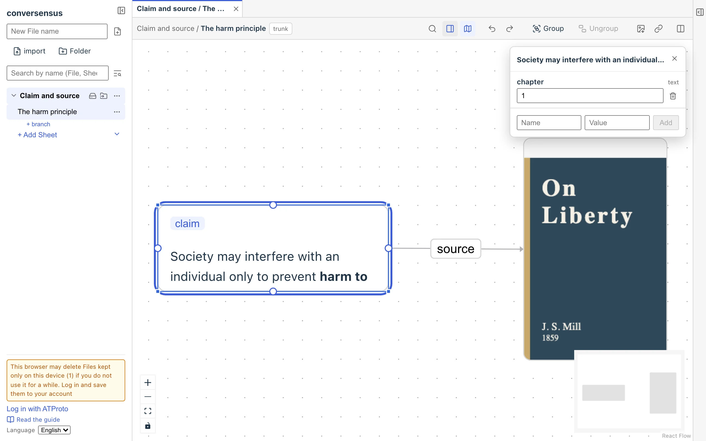

# What is conversensus

conversensus is a tool for thinking, writing/drawing, and conversing with graphs.

Here, a "graph" means a network-shaped figure made of boxes (nodes) connected by lines (edges).

Graphs can be described abstractly in mathematical terms, but we work with a more concrete kind of graph that can carry richer content: the Labelled Property Graph (LPG for short).

That is, nodes and edges can have a label and any number of properties (neither is required). In an LPG, a label is just a label: its meaning is not fixed, and you can change it later. However, particular templates and extensions give labels a meaning, and some of them make the labels unchangeable (the Toulmin model introduced in "Graph kata" is an example).

A node can also hold various contents, and edges are directed. There are no other rules.

<figure>
	
	<figcaption>A simple graph</figcaption>
</figure>

If we think of the conversensus LPG as a kind of language, it is a language in which "the relation between one thing and another" can be expressed more clearly than in natural language.

Since you can also use natural language in the labels and contents of an LPG (and we expect that to be the common case), you can think of conversensus as an extended language with natural language embedded in it, or as a higher-order (meta) language: expressions about expressions in natural language.

conversensus is a tool for thinking, expressing, and conversing in such a language (shall we call it a graph language?).

conversensus is not meant for broadcasting to millions of unspecified people.

It aims to help communication within communities of a few hundred to a few thousand participants, and between such communities. Of course, using it alone or with a few people is perfectly fine too.

This guide is for people who have never used conversensus, and gives you what you need to start using it.
