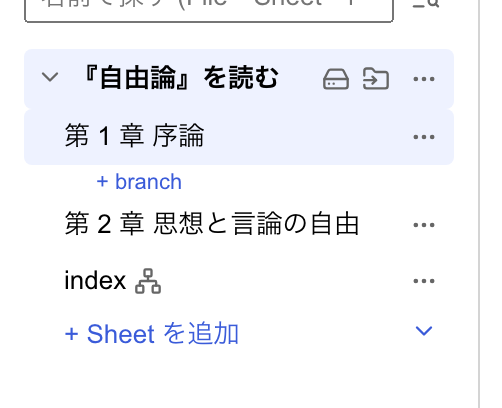
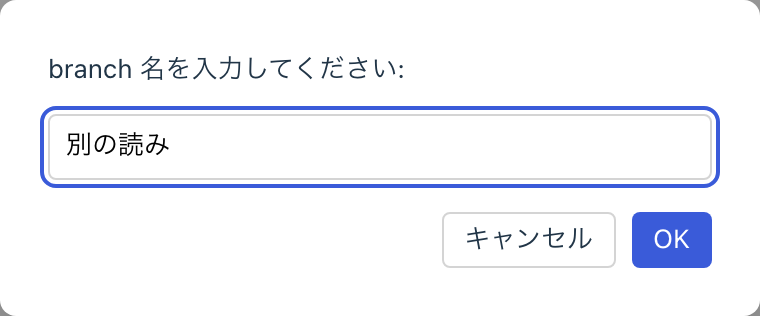
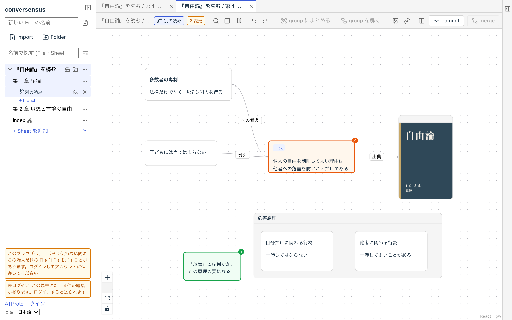
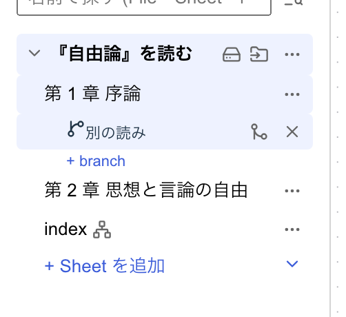
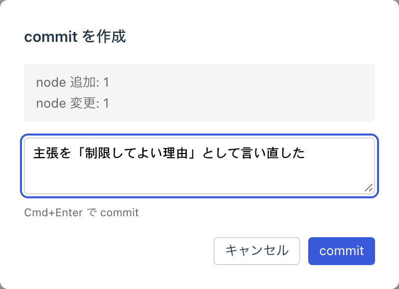
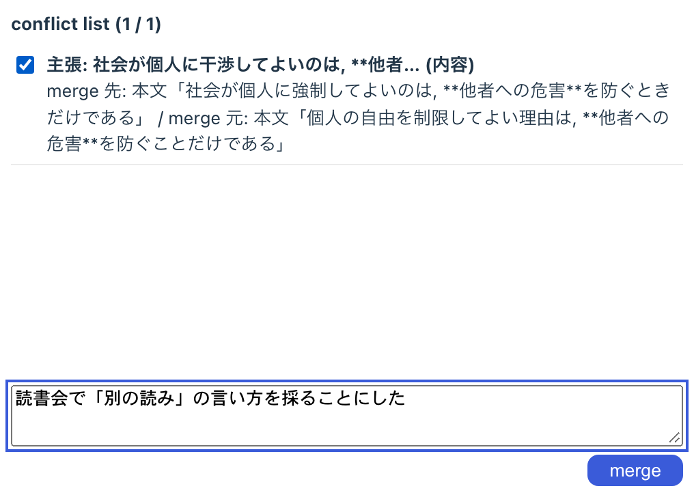
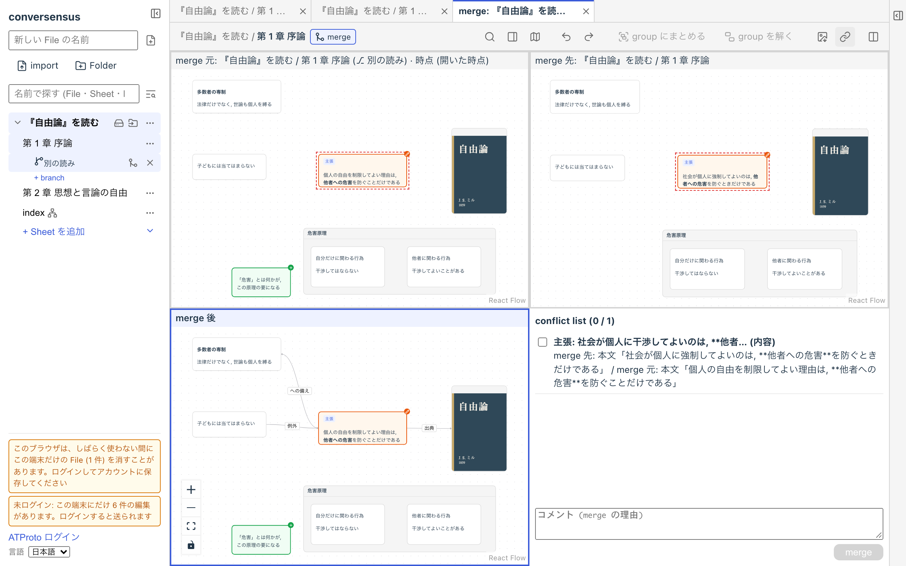
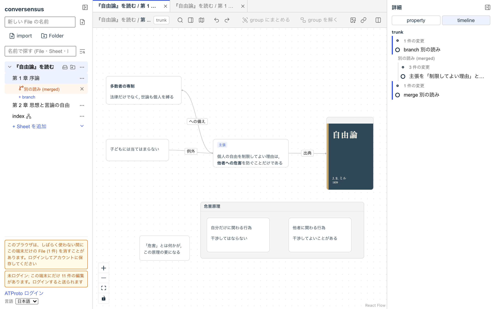

# 成長するグラフ

conversensus のグラフは, なんらかのもの (node) とものの間の関係 (edge) を表現しています. とは言うものの, それはそのグラフの「ある瞬間」(現在) の姿を見せているだけです.

たいていのグラフは, 一つか数個の node から始まり, 少しずつ成長していくものです. conversensus では, グラフの変化の過程をすべて記録しています.

また, 成長する過程は必ずしも一直線ではありません. 行ったり来たり, 試してみたり, やり直してみたり. conversensus では, 一つのグラフに対して複数のヴァージョンを保持することができます.

それは, あるグラフの各ヴァージョンを node とし, その間の更新関係を edge とする, 木の形をしています. conversensus ではこれを version tree と呼びます.

conversensus では, 現在のグラフだけではなく, グラフの成長過程, グラフの複数のヴァージョンも同じくらい重要だと考えます.

## trunk (幹)

あるグラフの「正規」あるいは「最新」版. グラフごとに一つだけあります. Sheet そのものが trunk を表しています.

<figure>
	
	<figcaption>trunk</figcaption>
</figure>

## branch (枝)

trunk から枝分かれしたヴァージョン, あるいは枝分かれを作ること自体です. いつでも, 幾つでも branch を作ることができます. branch は, 作った時点の trunk (の最新の状態) から枝分かれします. trunk の過去の時点から branch を作ることはできません.

branch は, 左サイドバーの Sheet の行にあるボタンから作ります.

branch には名前を付けることができます.  branch を作った意図が分かるような名前をつけるといいでしょう. 後で変えることもできますから, 考えすぎる必要はありません.

<figure>
	
	<figcaption>branch 作成</figcaption>
</figure>

branch を変更すると, その変更は branch に蓄積されていきます. branch のグラフには, 直前の commit (次節参照) からの差分が示されます.

<figure>
	
	<figcaption>branch に変更を重ねる</figcaption>
</figure>

branch を閉じると branch への変更はできなくなります. また branch を削除すると, 左サイドバーに表示されなくなります.

<figure>
	
	<figcaption>branch の close/delete</figcaption>
</figure>

## commit (確定)

commit は, branch に対する変更に区切りを付ける印です. commit ごとにその理由を記述します.

<figure>
	
	<figcaption>commit</figcaption>
</figure>

ある branch を commit した後も, その branch への変更を積み重ねていくことができます.

## merge (合流)

branch を merge するとは, branch に対する commit を trunk に取り込むことです. branch にまだ commit されていない変更があると, merge はできません.

<figure>
	
	<figcaption>merge</figcaption>
</figure>

merge は, header の「merge」(または左サイドバーの branch の行にある「trunk に merge」) で行います. 衝突がなければ, merge する理由を記述するだけで, branch の変更が trunk に取り込まれます.

ただし, branch を作った後で trunk も変更されている場合には, branch の変更と trunk の変更の間に衝突 (同じ部分に対する異なる変更) がある可能性もあります. conversensus は衝突を次の 3 種類に分けて扱います.

- 内容の衝突

  同じ node や edge の内容や property を, 両方が別々に書き換えた場合です. どちらを採るかは, 人が決める必要があります

- 構造の衝突

  片方の操作が, もう片方の前提を壊している場合です. 例えば, 片方が消した node に, もう片方が edge を繋いでいる場合などです

- 位置・大きさの衝突

  同じ node の位置や大きさを, 両方が別々に変えた場合です. 後から来た方になり, 人の判断は求めません

内容や構造の衝突があると, merge の前に merger の画面が開きます.

merger の画面には, 上に merge 元 (branch の, 開いた時点の姿) と merge 先 (trunk) が, 下に merge 後のグラフと衝突の一覧 (conflict list) が並びます. merge 元と merge 先は見るだけで, 編集できるのは merge 後だけです. merge 元や merge 先の要素を右クリックして「merge 後に取り込む」を選ぶと, merge 後のグラフがその要素の姿に揃います.

衝突の一覧の衝突をすべて確かめて印を付け, merge の理由を書いて「merge」を押すと, merge 後のグラフが trunk に取り込まれます.

<figure>
	
	<figcaption>衝突の解決</figcaption>
</figure>

merge 後も branch は存続し, 変更と commit を積み重ねることができ, 必要ならば再度 merge できます.

## history (履歴)

グラフの変更はすべて記録されています. 右サイドバーの timeline を開くと, そのグラフの履歴を見ることができます.

timeline には version tree が表示され, trunk と branch の分かれ方と, それぞれの commit や merge を見ることができます. その下には, 変更がまとまり (batch) ごとに並び, 開くと, 誰がいつ何をしたか, それに関係する node/edge を見ることができます.

「その時点のグラフを開く」を押すと, 過去のある時点のグラフがタブに表示されます. 過去の時点のグラフは読み取り専用で, 編集することはできません.

header の「この view のリンクを写す」で, いま見ているグラフ (Sheet や branch) へのリンクを OS のクリップボードにコピーできます. このリンクを開くと, conversensus でそのグラフが表示されます.

<figure>
	
	<figcaption>timeline pane の例</figcaption>
</figure>

---

## ここにあるもの

- trunk
- branch
- commit
- merge
- version tree
- timeline

## ここでできること

- trunk
  - branch を作成する (その時点の trunk から)
- branch
  - 変更する
  - commit する
  - trunk に merge する
  - close する
  - 削除する
- merge
  - trunk との差分を確かめる
  - merge の理由を記述する
  - 保留した衝突を merger で決める
- history
  - version tree を見る
  - 変更の履歴を見る
  - 過去の時点のグラフを開く (読み取り専用)
  - いま見ているグラフへのリンクをコピーする
