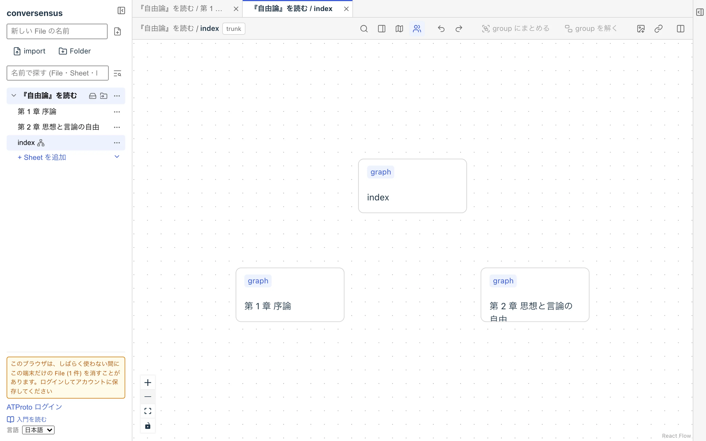
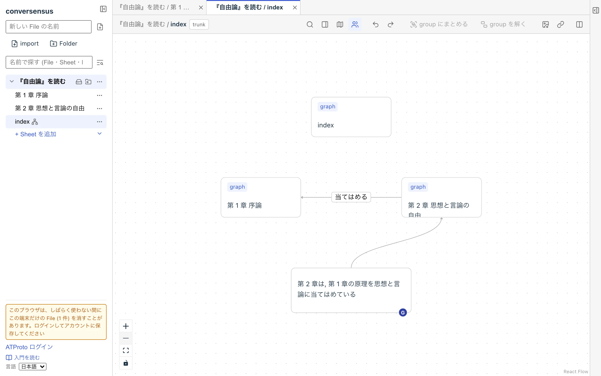
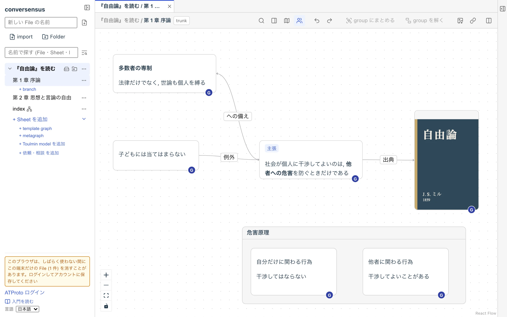
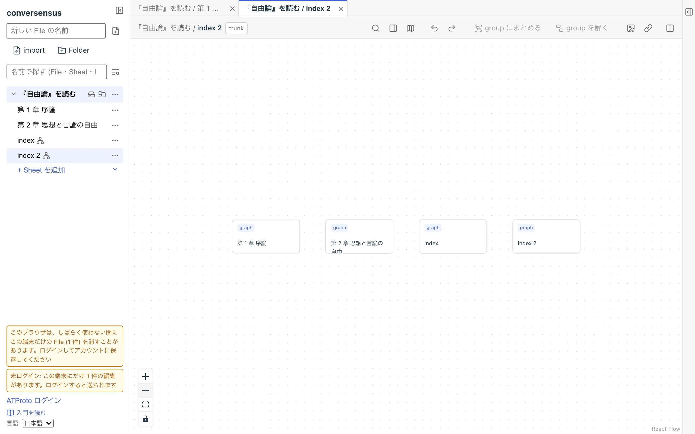
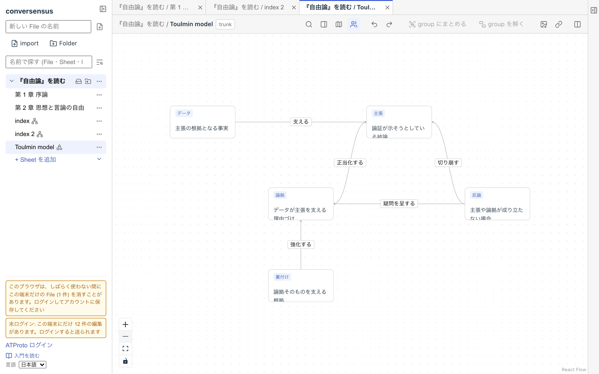
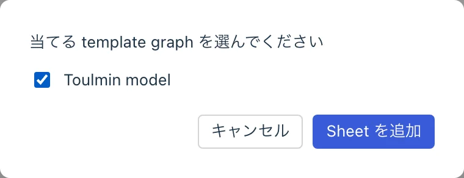
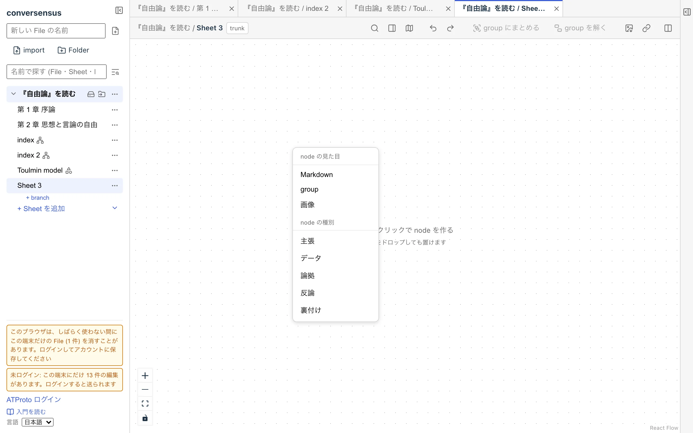
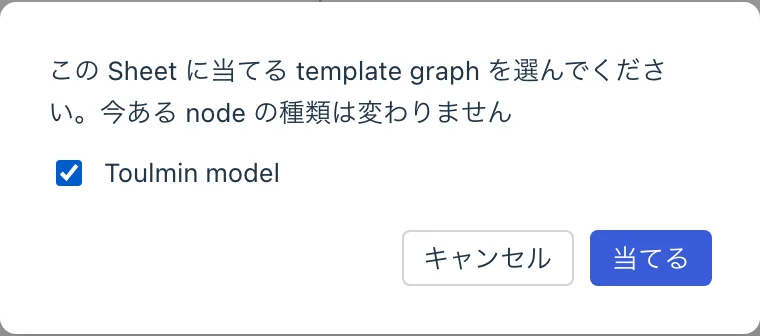

# グラフのカタ

conversensus は, あらかじめいくつかの決まった種類のグラフや node を用意しています. それらを用いて, あなたのグラフ記述に活かすことができます.

今後, conversensus の標準機能としてさらに追加されたり, 拡張機能のインストールを通じて追加される可能性もあります.

ここでは, 今用意されているものの中からいくつかを紹介します.

## metagraph

metagraph は, グラフ (実際には グラフを描いている Sheet) を node とするグラフです. グラフを対象とするグラフなので, metagraph と呼びます.

File を新たに作成すると, index という名前の metagraph が特別な Sheet として作成されます. File に Sheet を追加するたびに, その Sheet に対応する node (graph node と呼びます) が index に追加され, Sheet を削除すると, その Sheet に対応する graph node が index から削除されます.

逆も同じです. index で node を作るときに「グラフ」を選ぶと Sheet が追加され, graph node を削除すると (確認のダイアログの後で) その Sheet が削除されます. graph node の名前を変えると, Sheet の名前も変わります. つまり, File の Sheet と metagraph の graph node は同期しています. index 自身も, 一つの graph node として index に現れます.

graph node には `graph` というラベルが付いていて, ふつうの node と見分けられるようになっています. このラベルは変えられません.

<figure>
	
	<figcaption>デフォルトの index</figcaption>
</figure>

ユーザが, index に (graph node 以外の) 任意の node や edge を追加することができます. つまり, この File にある Sheet の間の関係を記述したり, コメントを残したりすることができます.

graph node をダブルクリックすると, その Sheet がタブに表示されます.

<figure>
	
	<figcaption>index</figcaption>
</figure>

また, File 作成時に同時に作られる index に加えて, 独自の metagraph を作ることもできます. 左サイドバーの「+ Sheet を追加」の横の ▾ から「+ metagraph」を選択します.

これによって, File 内の Sheet の関係に複数の異なる視点を表現することができます.

<figure>
	
	
	<figcaption>metagraph</figcaption>
</figure>

## toulmin model

左サイドバーの「+ Sheet を追加」の横の ▾ から「+ Toulmin model を追加」を選ぶと, File に Toulmin モデルの template graph が加わります. その後で「+ Sheet を追加」を押すと, 新しい Sheet に当てる template graph を選べるので, Toulmin モデルを選ぶと, Toulmin モデルをベースとしたグラフを描くための Sheet が作れます.

Toulmin モデルとは, ある問題に関する論理的な議論や分析を行うためのベースとなるグラフ (図式) のことで, 論証の分析に使われます (Toulmin は, このモデルを提案した哲学者の名前です).

<figure>
	
	
	
	<figcaption>toulmin モデル</figcaption>
</figure>

Toulmin model の Sheet では, 上記の図式に従った node を作成し, その間を図式に従った edge で結ぶことができます. 図式に従った node のラベル (「主張」など) は template が決めたもので, 変えることはできません (ラベルは, 見る人の言語で表示されます. 詳しくは「template graph」の「種類の名前を言語ごとに持つ」を見てください). 図式以外の任意の node を作り, 自由にラベルを付け, edge で結ぶこともできます.

例えば, あるテーマのグラフがあり, そのグラフに関するいくつかの議論をそれぞれの Toulmin モデルで行ったならば, それらの間の関係を metagraph 上に記述しておくとよいでしょう.

また, conversensus が Toulmin model を提供しているのはあくまで一つの利用例としてであり, これが公認された議論の唯一の方法であると主張しているわけではないことに注意してください.

## template graph

template graph は, グラフ上に描ける node の種類や node の種類によって決まる edge の種類, それらで有効となる property などを定義するものです.

実は, toulmin model もこの template graph を利用して定義されています.

詳細はここには書きませんが, Toulmin model のテンプレートを見ると, グラフの構造が素直に定義できているのが分かると思います.

template graph は, 自分で作ることもできます. 「+ Sheet を追加」の横の ▾ から「+ template graph」を選んで作った Sheet にグラフを描くと, それがそのまま template になります. ラベルのある node は node の種類になり, ラベルのない node は説明書きになります.

### 作った後で当てる

template は, Sheet を作るときだけでなく, すでにある Sheet に後から当てることもできます. Sheet の「…」から「template を当てる」を選び, 当てたい template graph を選んで「当てる」を押します (何も選ばないうちは押せません). 以後その Sheet で node を作るときの種類のメニューに, その template の種類が加わります.

<figure>
	
	<figcaption>すでにある Sheet に template を当てる</figcaption>
</figure>

- その Sheet にすでにある node の種類は変わりません
- 当てた後で template graph を編集しても, 当てた Sheet には当てたときの姿のままです
- 当てた template を外す操作は, 今はありません
- File に当てられる template graph がないとき (すでに当てたものを除きます) や, その Sheet 自身が template graph のときは,「template を当てる」は出ません

### 種類の名前を言語ごとに持つ

template graph の種類 (node や edge) には, 言語ごとの名前と説明を持たせることができます. 種類の node の property に, `label:ja` = 主張, `label:en` = Claim のように書きます (説明は `description:ja` / `description:en`). その template を当てた Sheet では, 見る人の言語で表示されます. 例えば Toulmin model の Sheet は, 日本語の人には「主張」「データ」「支える」, 英語の人には「Claim」「Data」「supports」と見えます. 種類のメニューも同じです.

- 見る人の言語の訳がないときは, template graph に書いた名前のまま表示されます
- 変わるのは表示だけで, 保存されるものは変わりません
- 以前から File にある Toulmin model は訳を持っていないので, property を足すまでは日本語のままです. 新しく「+ Toulmin model を追加」したものは, 日本語と英語の訳を持っています

---

## ここにあるもの

- metagraph
- toulmin model
- template graph

## ここでできること

- metagraph
  - file 内のグラフを一覧する
  - file にグラフ上からグラフを追加, 削除する
  - file 内のグラフの間の関係やコメントをグラフとして記述する
  - file 内のグラフの構造について, 複数の視点を提供する
- template graph
  - node/edge の種類, node 間の関係があらかじめ決まっているようなグラフの型をグラフとして定義する
  - そのグラフのかたの定義に基づいて, sheet を作成する
  - すでにある sheet に, 後から template を当てる
  - 種類の名前と説明を, 言語ごとに持たせる (見る人の言語で表示される)
  - 既存の template graph を元に, 拡張や変更した template graph を作る
- toulmin model
  - template graph のサンプルとなる
  - 議論や論証分析のためのグラフの型として利用する
  - ユーザの用途に応じた議論のグラフとしてカスタマイズする
