# グラフのカタ

conversensus は, あらかじめいくつかの決まった種類のグラフや node を用意しています. それらを用いて, あなたのグラフ記述に活かすことができます.

今後, conversensus の標準機能としてさらに追加されたり, 拡張機能のインストールを通じて追加される可能性もあります.

ここでは, 今用意されているものの中からいくつかを紹介します.

## metagraph

metagraph は, グラフ (実際には グラフを描いている Sheet) を node とするグラフです. グラフを対象とするグラフなので, metagraph と呼びます.

File を新たに作成すると, index という名前の metagraph が特別な Sheet として作成されます. File に Sheet を追加するたびに, その Sheet に対応する node (graph node と呼びます) が index に追加され, Sheet を削除すると, その Sheet に対応する graph node が index から削除されます.

逆も同じです. index で node を作るときに「グラフ」を選ぶと Sheet が追加され, graph node を削除すると (確認のダイアログの後で) その Sheet が削除されます. graph node の名前を変えると, Sheet の名前も変わります. つまり, File の Sheet と metagraph の graph node は同期しています. index 自身も, 一つの graph node として index に現れます.

graph node には `graph` というラベルが付いていて, ふつうの node と見分けられるようになっています. このラベルは変えられません.

<figure>
	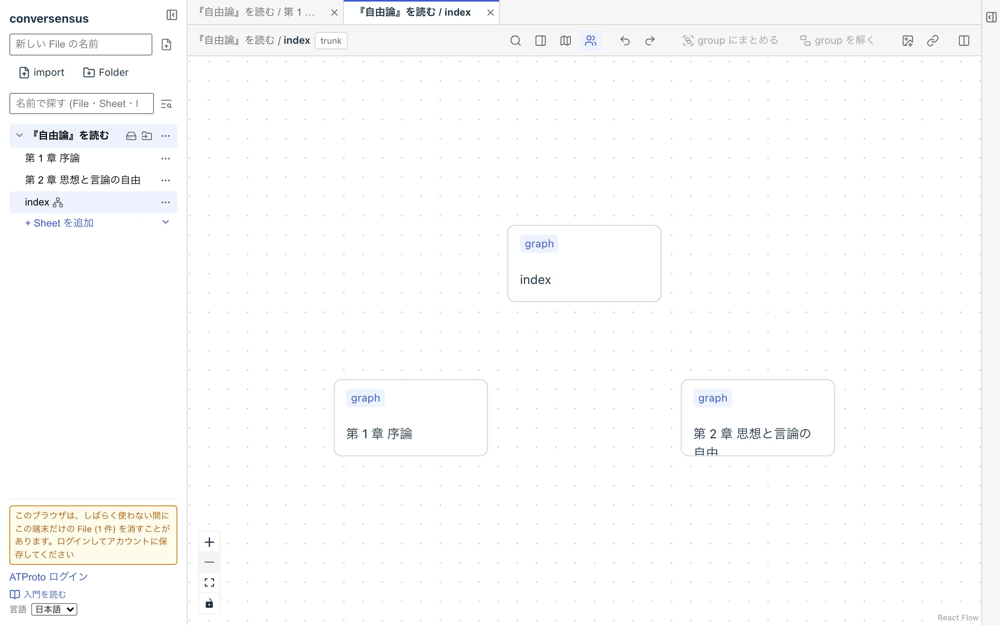
	<figcaption>デフォルトの index</figcaption>
</figure>

ユーザが, index に (graph node 以外の) 任意の node や edge を追加することができます. つまり, この File にある Sheet の間の関係を記述したり, コメントを残したりすることができます.

graph node をダブルクリックすると, その Sheet がタブに表示されます.

<figure>
	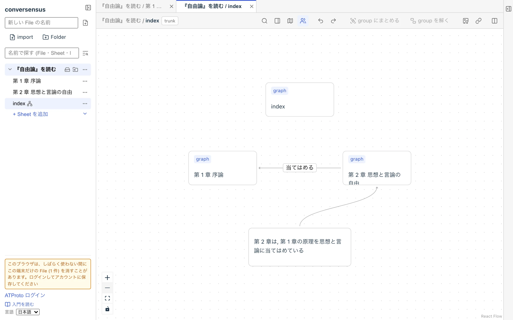
	<figcaption>index</figcaption>
</figure>

また, File 作成時に同時に作られる index に加えて, 独自の metagraph を作ることもできます. 左サイドバーの「+ Sheet を追加」の横の ▾ から「+ metagraph」を選択します.

これによって, File 内の Sheet の関係に複数の異なる視点を表現することができます.

<figure>
	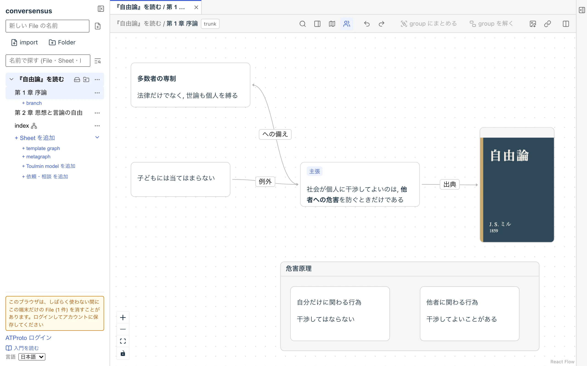
	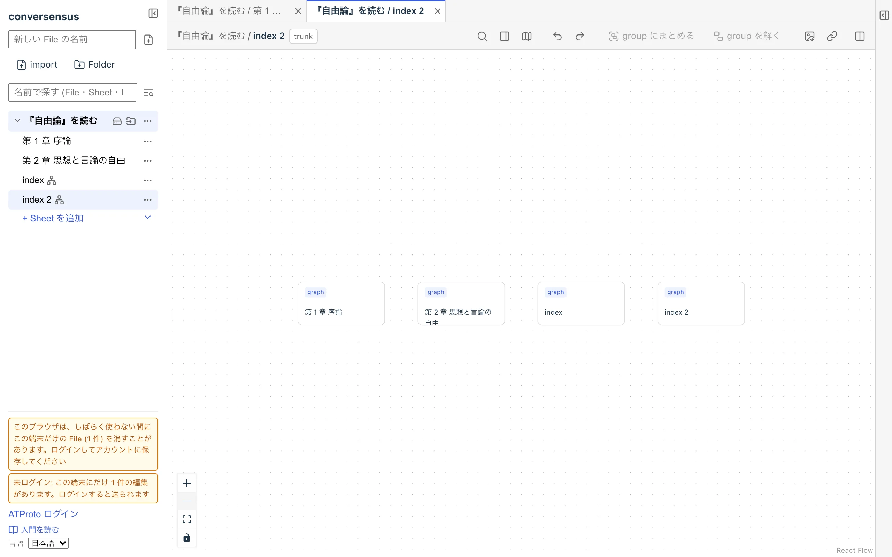
	<figcaption>metagraph</figcaption>
</figure>

## toulmin model

左サイドバーの「+ Sheet を追加」の横の ▾ から「+ Toulmin model を追加」を選ぶと, File に Toulmin モデルの template graph が加わります. その後で「+ Sheet を追加」を押すと, 新しい Sheet に当てる template graph を選べるので, Toulmin モデルを選ぶと, Toulmin モデルをベースとしたグラフを描くための Sheet が作れます.

Toulmin モデルとは, ある問題に関する論理的な議論や分析を行うためのベースとなるグラフ (図式) のことで, 論証の分析に使われます (Toulmin は, このモデルを提案した哲学者の名前です).

<figure>
	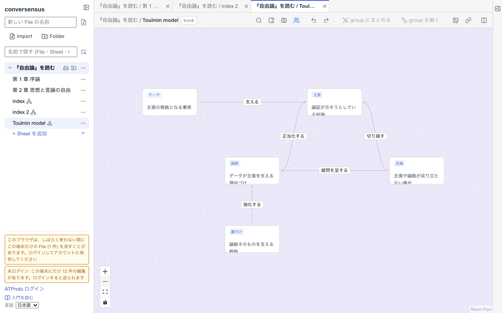
	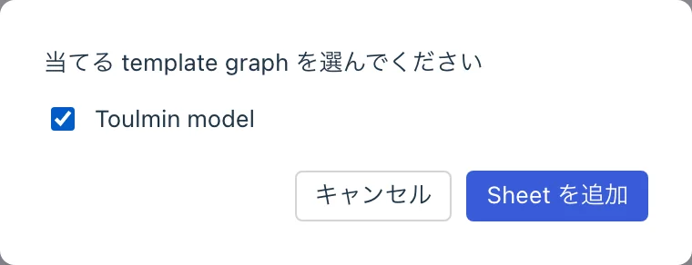
	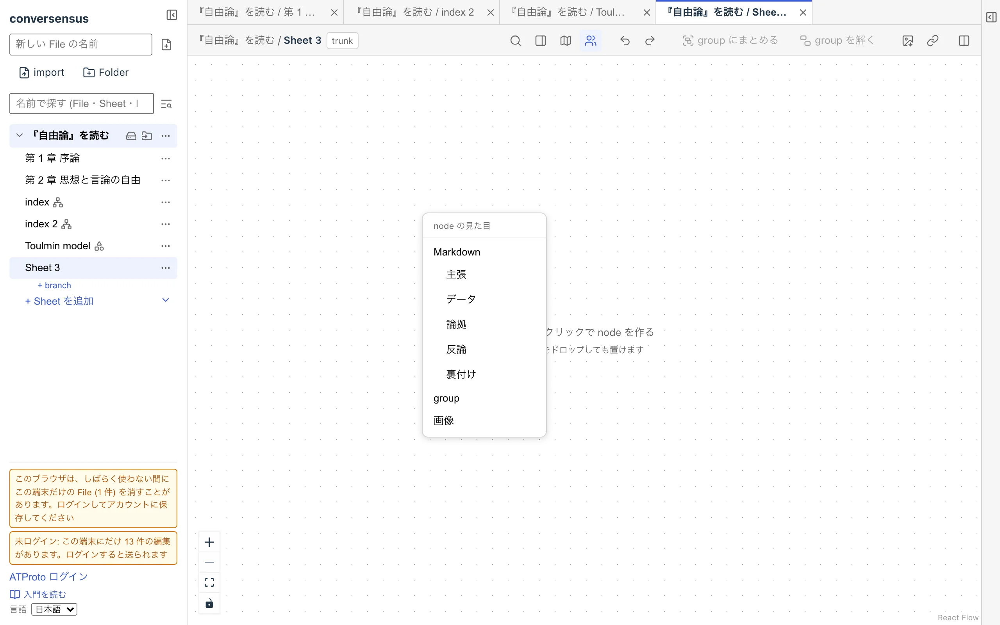
	<figcaption>toulmin モデル</figcaption>
</figure>

Toulmin model の Sheet では, 上記の図式に従った node を作成し, その間を図式に従った edge で結ぶことができます. 図式に従った node のラベル (「主張」など) は template が決めたもので, 変えることはできません (ラベルは, 見る人の言語で表示されます. 詳しくは「template graph」の「種類の名前を言語ごとに持つ」を見てください). 図式以外の任意の node を作り, 自由にラベルを付け, edge で結ぶこともできます.

例えば, あるテーマのグラフがあり, そのグラフに関するいくつかの議論をそれぞれの Toulmin モデルで行ったならば, それらの間の関係を metagraph 上に記述しておくとよいでしょう.

また, conversensus が Toulmin model を提供しているのはあくまで一つの利用例としてであり, これが公認された議論の唯一の方法であると主張しているわけではないことに注意してください.

## template graph

template graph は, グラフ上に描ける node の種類や node の種類によって決まる edge の種類, それらで有効となる property などを定義するものです.

実は, toulmin model もこの template graph を利用して定義されています.

詳細はここには書きませんが, Toulmin model のテンプレートを見ると, グラフの構造が素直に定義できているのが分かると思います.

template graph は, 自分で作ることもできます. 「+ Sheet を追加」の横の ▾ から「+ template graph」を選んで作った Sheet にグラフを描くと, それがそのまま template になります. ラベルのある node は node の種類になり, ラベルのない node は説明書きになります.

### 種類の書き方

template graph に描いたものは, 当てた Sheet で次のように働きます.

- **node の見た目**: 種類の node の見た目 (Markdown・group・画像) が, その種類の見た目になります. 当てた Sheet で node を作るときのメニューでは, 見た目のすぐ下に, その見た目の種類が字下げで並びます. 例えば group の node に「議論」とラベルを付けておくと, 「議論」を選べば group の node ができます
- **名前の重なり**: 同じラベルの種類が 2 つあると, どちらも使えません (当てた Sheet のメニューに出ません). template graph の画面の上に警告が出るので, どちらかのラベルを変えてください
- **edge の種類**: 種類の node どうしを結んだ edge のラベルが, edge の種類になります. 当てた Sheet でその組の node を繋ぐと, 種類が一つに決まれば自動でそのラベルが付き, 複数あればメニューから選びます
- **「任意の node」への edge**: 種類の node とラベルのない node を結んだ edge は, 「その種類から (へ) 任意の node へ引ける edge」の種類になります. ただし, 引けるというだけで, 引かなければならないわけではないので, この種類は自動では付きません. 繋いだときにメニューが出て, その種類か「ラベルなしで繋ぐ」を選べます
- **property**: 種類の node / edge に書いた property は, 当てた Sheet のその種類の要素に現れます. 書いた値はその property の既定値で, 当てた Sheet の property の欄に薄く出ます (値を書くとその値になります). 欄には, property の名前に template の名前が添えられます
  - template graph の property の欄では, 行ごとに「型」を書けます. `string`・`number`・`boolean`・`date`・`datetime` と, その配列 (`string[]` など), 選択肢 (`'高' | '中' | '低'`) が書けます. 末尾に `?` を付けると (`date?`), 値がなくてもかまわない property になります. 型を書くと, 当てた Sheet では型に合わない値と, 値のない必須の property に印が付きます (印が付くだけで, 値はそのまま残ります). 選択肢の型は, 選んで入力します
  - 「適用先で編集できる」を外すと, 当てた Sheet ではその property の値は常に template の値になり, 変えられません (agent からも変えられません)
  - `kind` という名前は使えません (種類を表す property と重なるため)
- **本文**: Markdown の種類の node に書いた本文は, 当てた Sheet で作った node の本文が空の間, 薄く表示されます. 「結論を一文で」のような書き方の案内に使えます. 本文を書けば消えます

<figure>
	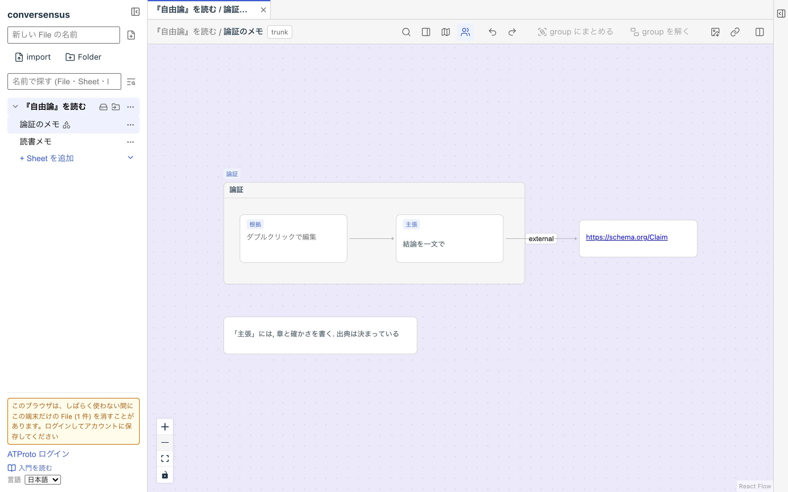
	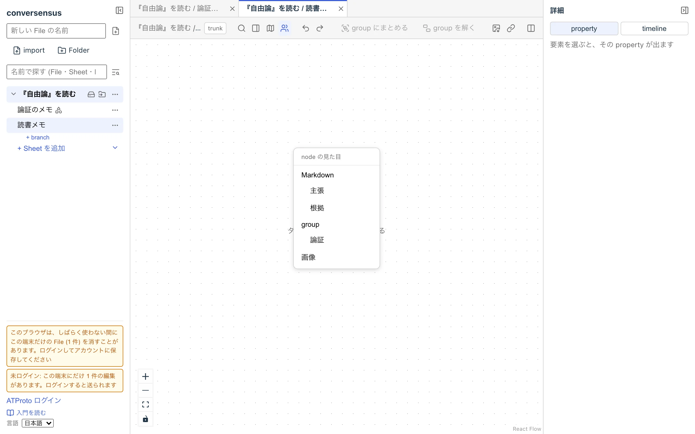
	<figcaption>手で書いた template graph と, それを当てた Sheet の種類のメニュー</figcaption>
</figure>

<figure>
	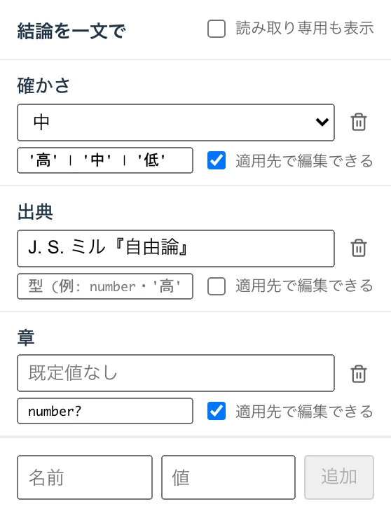
	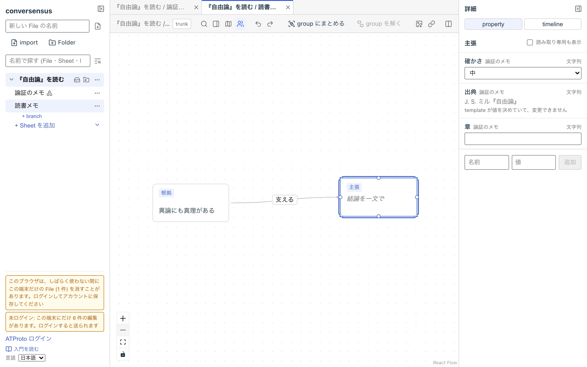
	<figcaption>template graph での property の宣言と, 当てた Sheet での見え方</figcaption>
</figure>

group の中に種類を描いても, その種類が group の中でしか使えなくなるわけではありません. conversensus は group を範囲としては扱わないので, 当てた Sheet ではどこにでも置けます. ただ, template を作った人がまとまりとして group の中に書いたのなら, その意図を汲んで, 当てた Sheet でも group の中に書くのがよいでしょう. つまり, template graph の group は緩いガイドラインです.

#### 既存のオントロジに繋ぐ

既存のオントロジ (語彙) の概念と結び付けたいときは, template graph にラベルのない node を置いてその本文に概念の URI を書き, 種類の node からその node へ edge を引いて, `external` や `import` のような慣習のラベルを付けておくとよいでしょう. 上の「任意の node」への edge になるので, 当てた Sheet で自由に繋ぐ邪魔にはなりません.

### 作った後で当てる

template は, Sheet を作るときだけでなく, すでにある Sheet に後から当てることもできます. Sheet の「…」から「template を当てる」を選び, 当てたい template graph を選んで「当てる」を押します (何も選ばないうちは押せません). 以後その Sheet で node を作るときの種類のメニューに, その template の種類が加わります.

<figure>
	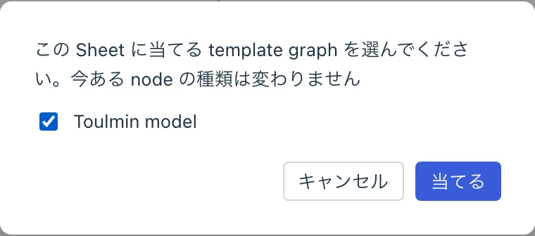
	<figcaption>すでにある Sheet に template を当てる</figcaption>
</figure>

- その Sheet にすでにある node の種類は変わりません
- 当てた後で template graph を編集しても, 当てた Sheet は当てたときの版のままです. 新しい版にするには, 次の「template を育てる」を見てください
- File に当てられる template graph がないとき (すでに当てたものを除きます) や, その Sheet 自身が template graph のときは,「template を当てる」は出ません

### template を育てる

template は, 最初から完成している必要はありません. グラフを描きながら, そこに現れたパタンを template graph に書き足していけば, template が育っていきます.

template graph を書き換えて, 当てた Sheet から見て種類が変わると (種類の追加・削除・名前の変更・edge の両端の組・property・本文), 画面の右下の「template の版」に「「〈Sheet〉」に当てた「〈template graph〉」に新しい版があります」と出ます. node を動かしただけ, ラベルのない node (説明書き) を足しただけでは出ません.

<figure>
	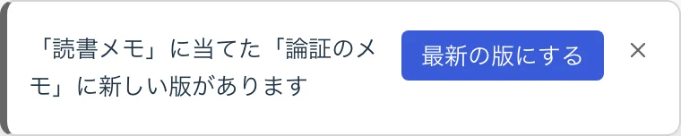
	<figcaption>新しい版の知らせ</figcaption>
</figure>

- 「最新の版にする」を押すと, その Sheet が template graph の今の版を使うようになります. Sheet の「…」にも, 新しい版があるときだけ「「〈template graph〉」を最新の版にする」が出ます
- × で閉じた知らせは, template graph がさらに変わるまで出ません
- 最新の版にすると, 既にある要素の種類の名前も新しい名前で表示されます
- 新しい版の規則に合わなくなった要素は, 消されも置き換えられもせずに残り, 印が付きます. 種類がなくなった edge や, 両端の組がもう許されない edge は, 警告色の破線になり, 線かラベルにマウスを重ねると理由が出ます. 型に合わなくなった property には, property の欄に印が付きます
- template graph の Sheet を削除すると,「…は削除されました. この Sheet は当てた版のまま使えます」と出ます. 当てた Sheet は, 当てていた版の種類のまま使えます
- 知らせは, 開いている File の分だけ出ます. 共同作業では, 誰かが最新の版にすると, ほかの参加者の知らせも消えます
- agent は最新の版にはしません. template の版を進めるのは Sheet 全体に効く判断なので, 人が行います

<figure>
	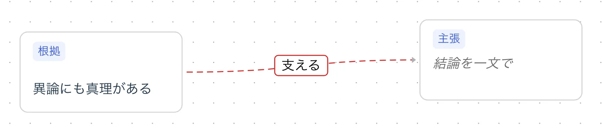
	<figcaption>種類がなくなった edge は, 消されずに警告色の破線になる</figcaption>
</figure>

### 当てた template を外す

後から当てた template は, Sheet の「…」の「「〈template graph〉」を外す」で外せます. 外すと, 種類のメニューからその template の種類が消えます. 既に作った node や edge は消えず, ラベルのまま残ります. 外した template は,「template を当てる」でまた当てられます.

<figure>
	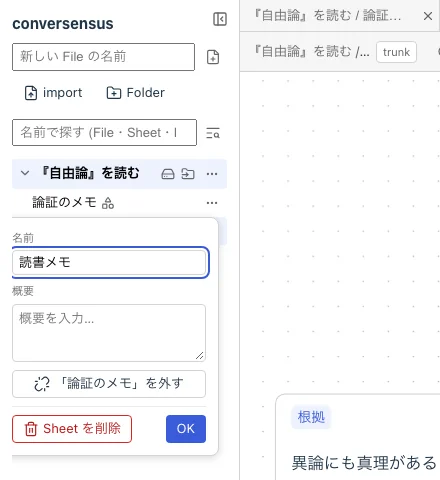
	<figcaption>後から当てた template を外す</figcaption>
</figure>

**Sheet を作るときに当てた template は外せません.** 作るときの template は Sheet を作ったことそのものに記録されていて, 後から取り消せないからです (最新の版にしたものでも, 外す入口は出ません). その template を使わない Sheet が欲しいときは, 新しい Sheet を作ってください.

### 種類の名前を言語ごとに持つ

template graph の種類 (node や edge) には, 言語ごとの名前と説明を持たせることができます. 種類の node の property に, `label:ja` = 主張, `label:en` = Claim のように書きます (説明は `description:ja` / `description:en`). その template を当てた Sheet では, 見る人の言語で表示されます. 例えば Toulmin model の Sheet は, 日本語の人には「主張」「データ」「支える」, 英語の人には「Claim」「Data」「supports」と見えます. 種類のメニューも同じです.

- 見る人の言語の訳がないときは, template graph に書いた名前のまま表示されます
- 変わるのは表示だけで, 保存されるものは変わりません
- 以前から File にある Toulmin model は訳を持っていないので, property を足すまでは日本語のままです. 新しく「+ Toulmin model を追加」したものは, 日本語と英語の訳を持っています
- template graph で種類のラベルを変えると, 変えた人の言語の訳 (日本語の画面なら `label:ja`) も一緒に変わります. ほかの言語の訳はそのまま残るので, その言語の人が訳し直してください

---

## ここにあるもの

- metagraph
- toulmin model
- template graph

## ここでできること

- metagraph
  - file 内のグラフを一覧する
  - file にグラフ上からグラフを追加, 削除する
  - file 内のグラフの間の関係やコメントをグラフとして記述する
  - file 内のグラフの構造について, 複数の視点を提供する
- template graph
  - node/edge の種類, node 間の関係があらかじめ決まっているようなグラフの型をグラフとして定義する
  - そのグラフのかたの定義に基づいて, sheet を作成する
  - 種類ごとに, node の見た目, property の既定値・型・編集できるかどうか, 本文の案内を決める
  - すでにある sheet に, 後から template を当てる. 後から当てたものは外す
  - グラフを描きながら template graph を書き足し, 当てた sheet を最新の版にする (新しい版は知らせが出る)
  - 種類の名前と説明を, 言語ごとに持たせる (見る人の言語で表示される)
  - 既存のオントロジの概念に繋ぐ
  - 既存の template graph を元に, 拡張や変更した template graph を作る
- toulmin model
  - template graph のサンプルとなる
  - 議論や論証分析のためのグラフの型として利用する
  - ユーザの用途に応じた議論のグラフとしてカスタマイズする
