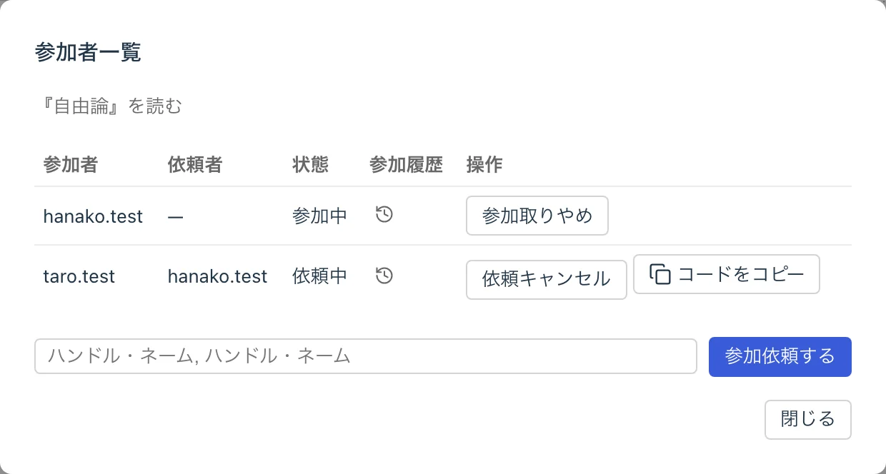
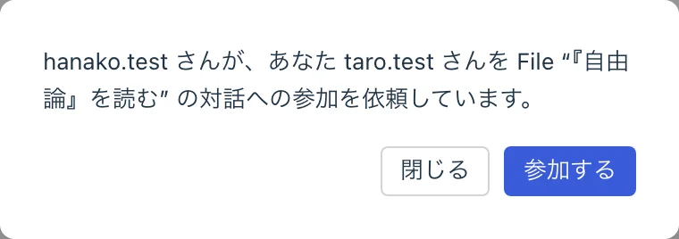
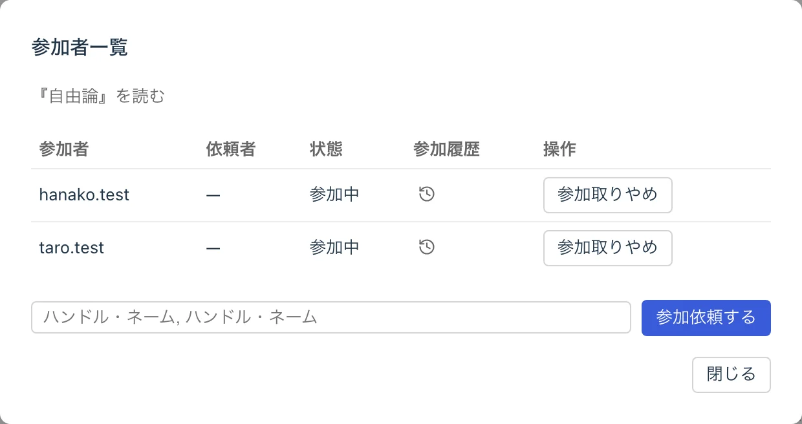
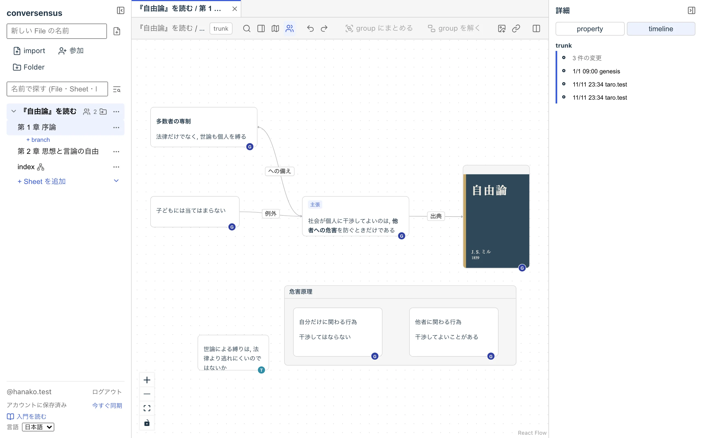
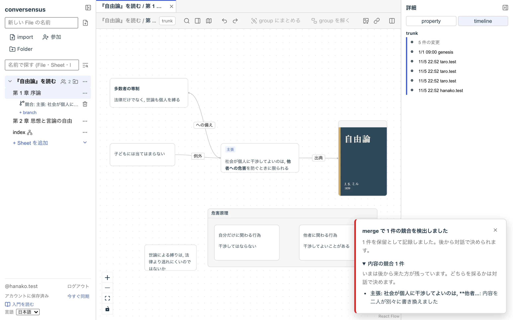
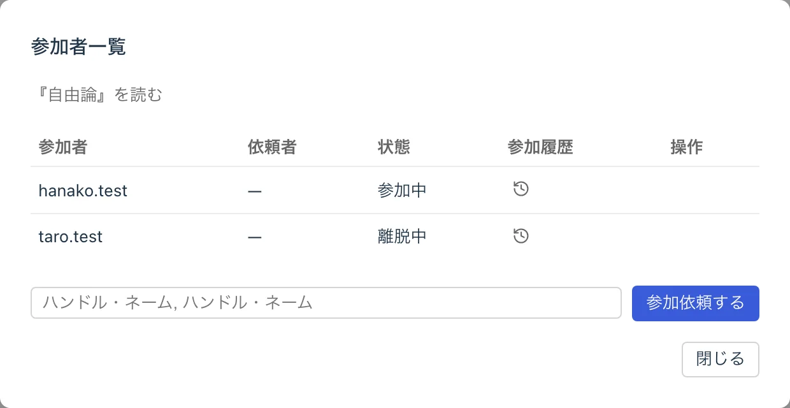

# グラフで対話する

conversensus は, File の編集に他のアカウントの参加を依頼し, その人たちと一緒にグラフを育てていくことができます.

File の編集に参加を依頼できるのは, ATProto アカウントを持っている人です. ただし現時点では, 依頼する人と同じ PDS にアカウントを持っていることが必要です.

## 参加を依頼する

File の参加者一覧を開き, 参加を依頼したい人のハンドル名を入力して「参加依頼する」を押します. ハンドル名は, カンマで区切って複数入力することもできます.

<figure>
	
	<figcaption>参加依頼</figcaption>
</figure>

依頼すると参加コードが発行されるので, それをコピーして, conversensus の外 (メールやチャットなど) で相手に渡します.

## 参加する

参加コードを受け取った相手は, 「参加コードで参加する」から参加コードを貼り付けます. 誰からどの File への参加依頼なのかが表示されるので, 確認して「参加する」を押すと, File の編集に参加できます.

<figure>
	
	<figcaption>参加</figcaption>
</figure>

参加者一覧では, 誰が参加しているか (依頼中, 参加中, 離脱中) と, 誰がいつからいつまで File の編集に参加していたか (参加履歴) を見ることができます.

<figure>
	
	<figcaption>参加者一覧</figcaption>
</figure>

## 一緒に編集する

File の編集に参加している間, その人はその File に関するすべての操作を同じように行うことができます. 誰がその操作を行なったかは, すべて履歴に残ります.

<figure>
	
	<figcaption>複数のメンバが関わる履歴</figcaption>
</figure>

他の参加者の編集は, ほぼリアルタイムに自分の画面に届きます. しばらく参加していなかった (例えば, conversensus を開いていなかった) 間の編集を取り込んでいる間は, その File は読み取り専用になります. 取り込みが終われば, また編集できるようになります.

### 衝突

複数の人が同じところを同時に編集すると, 衝突が起きることがあります. conversensus は, 衝突を「成長するグラフ」の merge と同じく, 内容・構造・位置/大きさの 3 種類に分けて扱います.

衝突は画面の通知で知らされます.

- 位置や大きさの衝突は, 後から来た方の編集になります. 通知は結果の報告だけで, 対話は起こしません
- 内容や構造の衝突は, どちらを採るか人の判断が要ります. その場で決める必要はなく, 「保留」として記録しておいて, 後から merger の画面で対話しながら決めることができます. 相手の手元で見つかって保留された衝突も, 自分の画面に届きます

自分が書いたものが他の人の編集で変わったときには, 「上書きの報告」が表示されます.

別のタブで開いている File で衝突が起きたときには, そのタブに印が付きます.

<figure>
	
	<figcaption>衝突の通知</figcaption>
</figure>

## agent と一緒に

conversensus では, agent (人ではなく, プログラムとして動く参加者) も File に参加できます. agent は自分のアカウントを持ち, 人と同じ立場で File を読み書きします. 参加を依頼する手順も, 人の場合と同じです. agent が書いたものは, 他の参加者の画面にも同じように届きます.

### agent の印

- node や edge に書いた人の avatar は, 人なら頭文字の丸, agent なら bot の印になります. 上に mouse を置くと, ハンドル名と「agent」が出ます
- 参加者一覧の agent の行には,「agent」の印と, その agent の持ち主 (operator) が出ます

agent であることは, agent 自身が名乗るものです. その agent が本当に自分のものだと operator が確かめたときは, 参加者一覧で「自分の agent と認める」を押すと, 印が「agent (名乗りのみ)」から「agent (裏付けあり)」に変わります. 「認めるのをやめる」を押すと戻ります. これは表示のための印で, agent にできることは変わりません.

### 依頼と相談

誰か (人でも agent でも) に応えてほしいことは, 「依頼」や「相談」の node として送ることができます (ここでいう依頼は, 先に説明した「参加依頼」とは別のものです). これらは「依頼・相談」という template graph の種類です. Sheet を作るとき (またはすでにある Sheet に後から) 「依頼・相談」の template を当てると, node の種類のメニューに「依頼」「相談」が出ます.

1. 「依頼」の node を作り, 本文に頼みたいことを書きます
1. node を選ぶと, node のそばに操作が出ます (右クリックのメニューにも同じものが出ます). 「送る」を押して, 宛先 (参加者から選びます) を決めます
1. 宛先の人には, 右下に「○○から依頼が届きました」と出ます. 「開く」を押すと, その依頼が選ばれます
1. 「答える」を押して答えを書くと, 依頼の右に答えの node がつながり, 依頼の印が「回答あり」になります

依頼の状態 (未回答, 回答あり など) は, 答えの node があるかどうかから求めたもので, 別に保存されているわけではありません. 依頼は「閉じる」ことも, 「送り直す」こともできます. 答えられないときは, その理由を答えとして書いてください.

依頼の通知が出るのは, 同期している File (開いている, またはタブにある File) だけです. 開いていない File への依頼は, 開くまで知りません.

> [!NOTE]
> agent を自分で動かす方法は, 開発者向けの文書にまとめる予定です (まだありません).

## 離れる

File の編集から本人が離れることも, 他の人が離すこともできます (「参加取りやめ」). 今のところ, そのためのシステム化されたプロトコルはありません. アカウントの加入/離脱については, あらかじめ conversensus の外で話し合いを持つことをお勧めします.

<figure>
	
	<figcaption>離脱</figcaption>
</figure>

誰も参加していない File は, 「この File を引き取る」で, 誰でも引き取って, 再び編集を始めることができます.

---

## ここにあるもの

- actor (参加者)
  - 人
  - agent
- 参加依頼 (invitation)
- 参加 (participation)
- 衝突 (conflict)
- 依頼・相談

## ここでできること

- 参加依頼
  - ハンドル名を入力して参加を依頼する
  - 参加コードをコピーする
  - 依頼をキャンセルする
- 参加
  - 参加コードを入力して参加する
  - 参加を取りやめる
  - 参加者一覧と参加履歴を見る
  - 誰も参加していない File を引き取る
- 衝突
  - 衝突の通知を見る
  - 保留した衝突を後から merger で決める
  - 上書きの報告を見る
- agent
  - agent の印 (avatar と参加者一覧) を見る
  - operator として agent を認める/認めるのをやめる
- 依頼・相談
  - 依頼や相談の node を作って送る
  - 届いた依頼に答える
  - 依頼を閉じる, 送り直す
