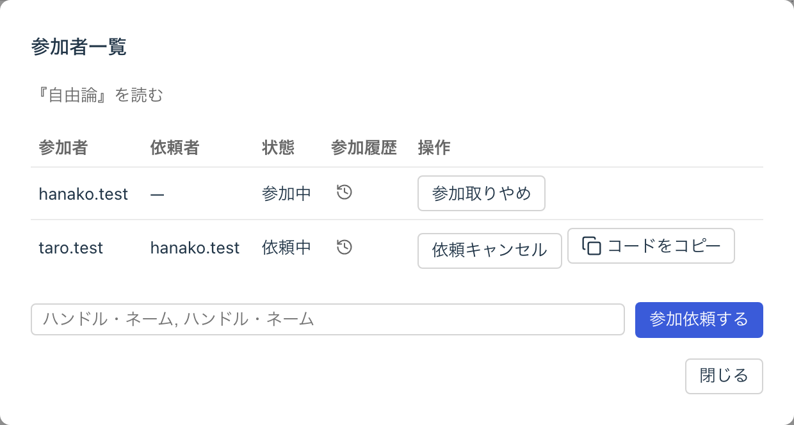
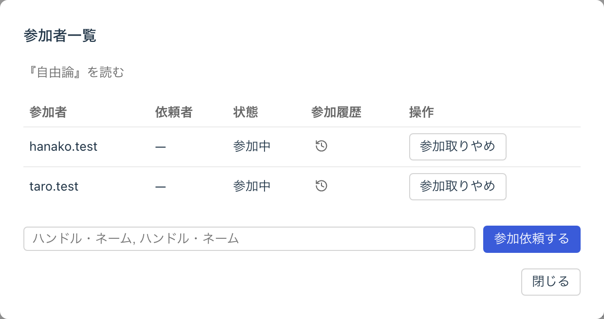
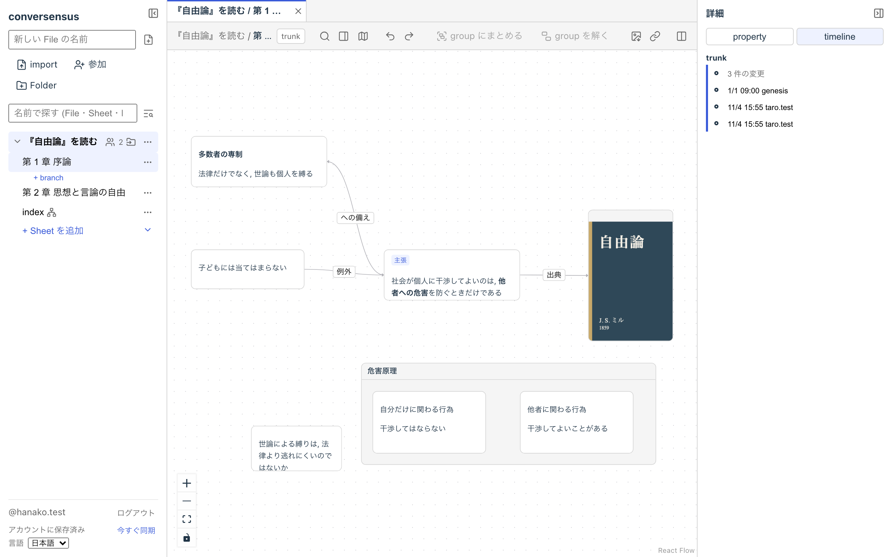

# グラフで対話する

conversensus は, File の編集に他のアカウントの参加を依頼し, その人たちと一緒にグラフを育てていくことができます.

File の編集に参加を依頼できるのは, ATProto アカウントを持っている人です. ただし現時点では, 依頼する人と同じ PDS にアカウントを持っていることが必要です.

## 参加を依頼する

File の参加者一覧を開き, 参加を依頼したい人のハンドル名を入力して「参加依頼する」を押します. ハンドル名は, カンマで区切って複数入力することもできます.

<figure>
	
	<figcaption>参加依頼</figcaption>
</figure>

依頼すると参加コードが発行されるので, それをコピーして, conversensus の外 (メールやチャットなど) で相手に渡します.

## 参加する

参加コードを受け取った相手は, 「参加コードで参加する」から参加コードを貼り付けます. 誰からどの File への参加依頼なのかが表示されるので, 確認して「参加する」を押すと, File の編集に参加できます.

<figure>
	
	<figcaption>参加</figcaption>
</figure>

参加者一覧では, 誰が参加しているか (依頼中, 参加中, 離脱中) と, 誰がいつからいつまで File の編集に参加していたか (参加履歴) を見ることができます.

<figure>
	
	<figcaption>参加者一覧</figcaption>
</figure>

## 一緒に編集する

File の編集に参加している間, その人はその File に関するすべての操作を同じように行うことができます. 誰がその操作を行なったかは, すべて履歴に残ります.

<figure>
	
	<figcaption>複数のメンバが関わる履歴</figcaption>
</figure>

他の参加者の編集は, ほぼリアルタイムに自分の画面に届きます. しばらく参加していなかった (例えば, conversensus を開いていなかった) 間の編集を取り込んでいる間は, その File は読み取り専用になります. 取り込みが終われば, また編集できるようになります.

### 衝突

複数の人が同じところを同時に編集すると, 衝突が起きることがあります. conversensus は, 衝突を「成長するグラフ」の merge と同じく, 内容・構造・位置/大きさの 3 種類に分けて扱います.

衝突は画面の通知で知らされます.

- 位置や大きさの衝突は, 後から来た方の編集になります. 通知は結果の報告だけで, 対話は起こしません
- 内容や構造の衝突は, どちらを採るか人の判断が要ります. その場で決める必要はなく, 「保留」として記録しておいて, 後から merger の画面で対話しながら決めることができます. 相手の手元で見つかって保留された衝突も, 自分の画面に届きます

自分が書いたものが他の人の編集で変わったときには, 「上書きの報告」が表示されます.

別のタブで開いている File で衝突が起きたときには, そのタブに印が付きます.

<figure>
	
	<figcaption>衝突の通知</figcaption>
</figure>

## 離れる

File の編集から本人が離れることも, 他の人が離すこともできます (「参加取りやめ」). 今のところ, そのためのシステム化されたプロトコルはありません. アカウントの加入/離脱については, あらかじめ conversensus の外で話し合いを持つことをお勧めします.

<figure>
	
	<figcaption>離脱</figcaption>
</figure>

誰も参加していない File は, 「この File を引き取る」で, 誰でも引き取って, 再び編集を始めることができます.

---

## ここにあるもの

- actor (参加者)
- 参加依頼 (invitation)
- 参加 (participation)
- 衝突 (conflict)

## ここでできること

- 参加依頼
  - ハンドル名を入力して参加を依頼する
  - 参加コードをコピーする
  - 依頼をキャンセルする
- 参加
  - 参加コードを入力して参加する
  - 参加を取りやめる
  - 参加者一覧と参加履歴を見る
  - 誰も参加していない File を引き取る
- 衝突
  - 衝突の通知を見る
  - 保留した衝突を後から merger で決める
  - 上書きの報告を見る
