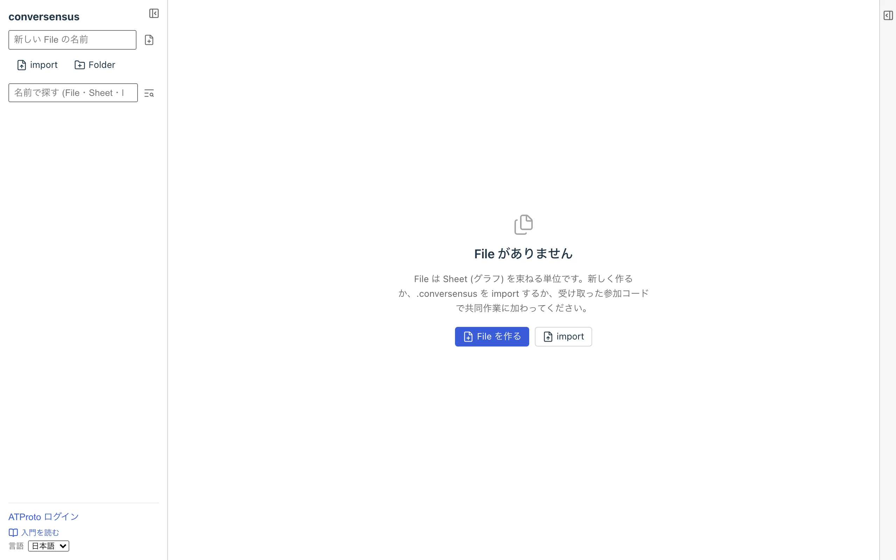

# 始める

conversensus を使い始めるには以下の方法があります.

1. ATProto アカウントを使わずに conversensus を使う
2. ATProto アカウントを使って conversensus を使う
   1. conversensus 公式の PDS サーバを使う
   2. それ以外の PDS サーバを使う
      1. 他の ATProto アプリケーションのアカウントを使う
      2. 自前で PDS サーバを立ち上げる

> [!NOTE]
> **少しだけ技術的な背景**
>
> ATProto とは Authenticated Transfer Protocol の略で, その名前の通り「認証された」通信プロトコルです. 最初は分散型 SNS である Bluesky のための通信プロトコルとして開発されたものですが, 今は Bluesky 以外の多くのアプリケーションでも使われています.
>
> ATProto には 多くのコンポネントがありますが, conversensus が利用しているのは PDS (Personal Data Server) だけで, PDS は次の機能を提供しています.
>
> - アカウントの登録と管理
> - データの保存
>
> アカウントは, それを登録した 1 つの PDS に属します. conversensus のような ATProto アプリケーションにログインするときは, 自分のアカウントがある PDS のページに移ってログインし, アプリケーションに戻ってきます. そのアカウントで作ったデータは, すべてアカウントを登録した PDS に保存されます.

> [!WARNING]
> **PDS に保存したデータは, 誰でも読むことができます**
>
> PDS に保存されたデータは, ATProto アカウントを持っていない人も含めて, 誰でも読むことができます. これは ATProto 自体が持つ特性です. 人に見られて困ることは, アカウントに保存するグラフには書かないでください.

## ATProto アカウントを使わずに conversensus を使う

ATProto アカウントを持っていなくても conversensus を使うことができます. Web ブラウザで `https://app.conversensus.site/` にアクセスするだけです.

ATProto にログインすることなく, conversensus を使ってグラフを描くことができます.

ただし, そこで作ったグラフはすべてその Web ブラウザの内部にしか保存されません. たいていの場合, いったん Web ブラウザを終了したり, ウィンドウを閉じたりしても, その時点でのグラフが保存されていますが, Web ブラウザによっては一定期間が過ぎれば消えてしまうこともあります. 消えるおそれがあるときは, 画面に警告が表示されます.

なお, Web ブラウザのプライベート・ブラウズのウィンドウでは, グラフを保存できません (「この窓では保存できません」と表示されます).

別の端末や同じ端末でも異なる Web ブラウザからそのグラフにアクセスすることはできませんが, 描いたグラフをその端末にファイルとして書き出したり, 読み込んだりすることはできます. 普通のデスクトップ・アプリケーションと同じです.

後で ATProto アカウントでログインすると, この端末だけにある File を「アカウントに保存する」か「この端末に残す」かを訊かれます. 端末に残した File も, 後から File の詳細の「アカウントに保存する」でアカウントに保存できます.

## ATProto アカウントを使って conversensus を使う

ATProto アカウントを持っていれば, 描いたグラフをそのアカウントの PDS に保存し, 任意の端末から共有することができます.

ATProto アカウントを取得するには, 以下の方法があります.

1. Bluesky など他の ATProto アプリケーションでアカウントを取得する

   既に ATProto アカウントを持っていれば, それを使うこともできます. ただし, グラフなどの conversensus 固有のデータも, その ATProto アカウントを取得した PDS に保存されることになります (例えば Bluesky アカウントならば Bluesky の PDS サーバ)

2. (現時点では唯一の) 公式 conversensus 向け PDS からアカウントを取得する

   私たちは今は, とても小さな PDS しか持っていません. したがって, その PDS へのアカウント登録は招待ベースであり, 一般に公開はしていません

3. 自前で conversensus 向け PDS を立ち上げる

   自前で PDS を立ち上げ, ATProto アカウントを発行することができます. 小規模な PDS を立ち上げることはそんなに難しいことではありません. このアカウントで描いたグラフは, その PDS に保存されます

ただし現状では, (1) - (3) のどの場合でも, 共同作業ができるのは同じ PDS にアカウントを持つ人の間だけです. 別の PDS のアカウントとの共同作業は, 近い将来できるようになる予定です

ATProto アカウントを使うかどうかは別として, とりあえず https://app.conversensus.site/ に Web ブラウザからアクセスすると, 次のような conversensus の画面が表示されます.

<figure>
	
	<figcaption>conversensus の初期画面</figcaption>
</figure>
