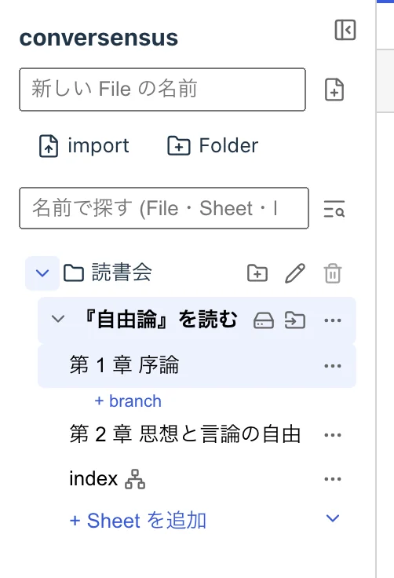

# グラフの置き場所

conversensus では, グラフを描く一枚の画面を Sheet (シート) と呼びます.

Sheet には, 名前を付けることができます.

関連する Sheet を集めたものを File (ファイル) と呼びます.

File には, 名前を付けることができます.

File を Folder (フォルダ) に入れて整理することもできます.

Folder は, Linux, macOS, Windows などの皆さんが利用している OS のファイル・システムと同じように, 名前を付けて, 階層化することができ, Folder の間で File を移動することができます.

これらは, 画面左側の左サイドバーに表示されます.

<figure>
	
	<figcaption>左サイドバー</figcaption>
</figure>

Sheet をクリックすると, その Sheet に描かれたグラフが, 画面中央のタブに表示されます.

「+ Sheet を追加」の横の ▾ からは, metagraph や template graph などの特別な Sheet を追加することができます. File に template graph があれば, 「+ Sheet を追加」のときに, 新しい Sheet に当てる template graph を選ぶこともできます (「グラフのカタ」参照).

左サイドバーの検索欄では, File, Sheet, Folder の名前で絞り込むことができます. また, ⌘⇧F (Windows などでは Ctrl+Shift+F) で開く検索では, File をまたいで, 名前と node の中身を探すことができます. どちらも概要欄の内容は検索の対象になりません.

なお, 中身のある Folder は削除できません. また, File の最後の Sheet は削除できません.

---

## ここにあるもの

- File
- Sheet
- Folder

## ここでできること

- File
  - 作成する
  - 削除する
  - 名前を付ける/変える
  - 概要を記述する
  - .conversensus ファイルとして export する
  - .conversensus ファイルを import する
  - 既にある Folder に移動する
- Sheet
  - 作成する (template graph を当てることもできる)
  - metagraph や template graph などの特別な Sheet を作成する
  - 削除する (最後の Sheet は削除できない)
  - 名前を付ける/変える
  - 概要を記述する
  - グラフを表示する
- File/Sheet/Folder
  - 名前で絞り込む (左サイドバー)
  - 名前と node の中身で File をまたいで検索する (⌘⇧F)
- Folder
  - 作成する
  - 削除する (空の Folder だけ)
  - 名前を付ける/変える
