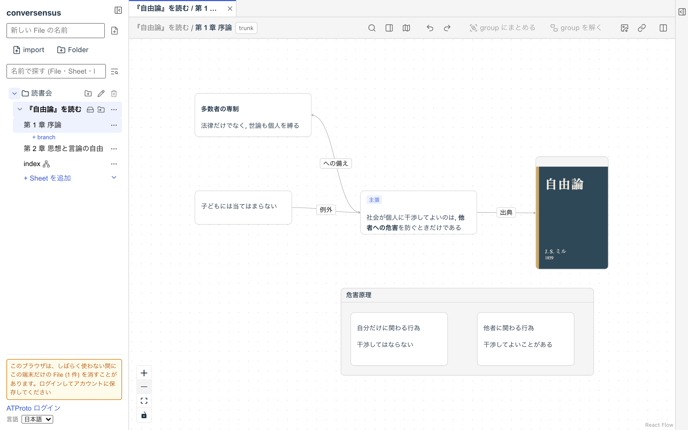
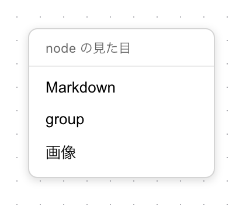
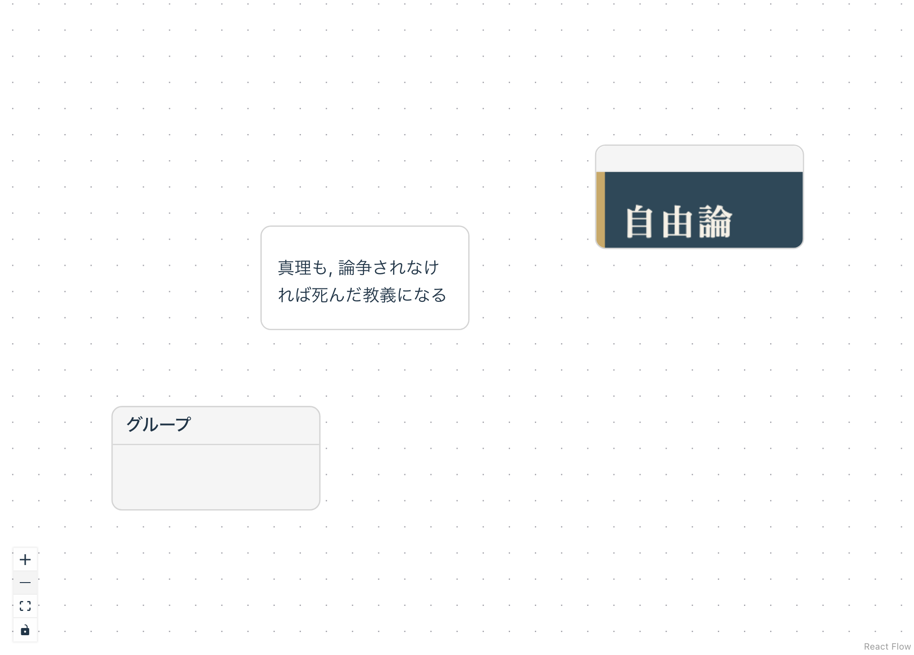

# グラフで考える

あなたが何か「考え事」をするとき, 見る/描く, 読む/書く, 聞く/話すのような言語行為が伴うことがあるでしょう.

もちろん, 言語行為の伴わない思考や認知もあります.

また, 肉体的行為が伴っていることが重要な場合もあります.

グラフを読み書きすることは, そのような言語行為の一つです. そして, それは自然言語を用いる言語行為とは, また異なる種類の言語行為ではないかと思います.

人の思考や認知の特異性によっては, グラフで書いたり, 読んだりすることが苦手な人, 拒否反応を起こしてしまう人もいるでしょう.

逆に, 自然言語で読み書きするのが不得意である人の中には, グラフで読み書きするのがより容易であると感じる人もいるのではないかと思います.

例えば私は, 本を読んだり, 人と話をしたりしているとき, 片っ端からそれをグラフで書き直したくなることがあります.

普通の書物のページには, そのような余白はほとんど残されていません. 普通の会話でそんなことをしていたら, 会話が途切れてしまったり, ついて行けなくなってしまいがちです.

conversensus は, そのような思考や認知の「癖」を持つ人に合わせて, 思考や認知を助けることを考慮して作っています (おもに自分のためですが).

そのような「癖」は, 生まれつきのものでもあるかもしれませんが, 発達の過程で社会的に作られたものでもあるかもしれません. とすると, 社会の形が変われば, さまざまな「癖」を持つ人が増えたり, あるいは減ったりするでしょう.

conversensus は, そのように多様な思考や認知の「癖」を支える道具を作る試みの一つです.

## グラフを落書きする

<figure>
	
	<figcaption>グラフの画面</figcaption>
</figure>

グラフの置き場所で, File を作り, その中の Sheet (File ができたときから含まれています) が選択されていると, 画面中央のグラフ (最初は何も表示されていません) にグラフを落書きすることができます.

### node

画面の何もない部分をダブル・クリックすると, node (ノード) を作成しようとします. 以下のような種類の node を作成することができます.

- markdown

  任意の文書を書くことができます. 簡易版の markdown 形式を理解して, 整形して表示されます

- group

  複数の node を一つのグループとして扱うことができます. node を drag して group に出し入れします

- 画像

  画像を表示します. 画像 URL を入力することもできますが, 画像ファイルをここに drop することもできます

<figure>
	
	
	<figcaption>node の作成</figcaption>
</figure>

node を drag して移動したり, node の枠線や四隅の点を drag して, 大きさを変えることができます.

複数選択, 削除, copy/paste なども普通の OS の作法に従って実行できます.

node にはラベルを付けることができます. node を選ぶと上辺に「label」の口が現れ, そこをクリックするとラベルを入力できます. 付けたラベルは後から変えることもできます (ただし template が決めたラベルは変えられません).

### edge

node の四辺中央の白丸は, edge で node 同士を接続する点です. ある node の接続点から drag して別の (自分自身も可) node の接続点で drop すると, それらの node が向きを付けて接続されます.

edge をダブル・クリックすると, ラベルを付けることができます. node のラベルと同じく, 後から変えることもできます.

edge を右クリックすると, 線の種類を選択することができます.

edge の両端の node を別の node に付け替えることはできますが, 両端に node のない edge は存在できません.

## header

header 部分には, 左側にはグラフの名前などの基本情報, 右側には実行可能なボタンなどが並んでいます.

- 左側 (情報)
  - File 名
  - Sheet 名
- 右側 (実行)
  - Sheet 内検索
  - property 表示 (右サイドバー)
  - map 表示 (本体画面右下)
  - undo/redo
  - グループ化/グループ化解除
  - png 書き出し
  - hyperlink コピー

## 右サイドバー

右サイドバーには, グラフで選択されている node/edge の property と変更履歴 (timeline) が表示されます.

## グラフの左下

グラフの左下には, 表示範囲の拡大/縮小, node/edge が存在する範囲の最大表示 (fit) のボタンが並び, その下に, グラフを一時的に編集不可にするボタンがあります. 誤ってグラフを動かしたくないときに使います.

---

## ここにあるもの

- graph
- node
  - markdown node
  - image node
  - group node
- edge

## ここでできること

- graph
  - node/edge を追加/削除する
  - 選択された node をグループ化/グループ化解除する
  - map を表示する
  - 表示範囲を拡大/縮小する
  - node/edge が存在する範囲を最大表示する
  - 一時的に編集不可にする (左下のボタン)
  - png として書き出す
  - この graph に対するハイパーリンクを OS のクリップボードにコピーする
- node
  - label を付ける/変える (template が決めた label は変えられない)
  - content を編集する (具体的には node の種類によって異なる)
  - 移動する
  - 大きさを変える
  - すでに存在する group node に/から出し入れする
  - property を表示する
  - 変更履歴を表示する
- edge
  - label を付ける/変える
  - 接続先の node を変更する
