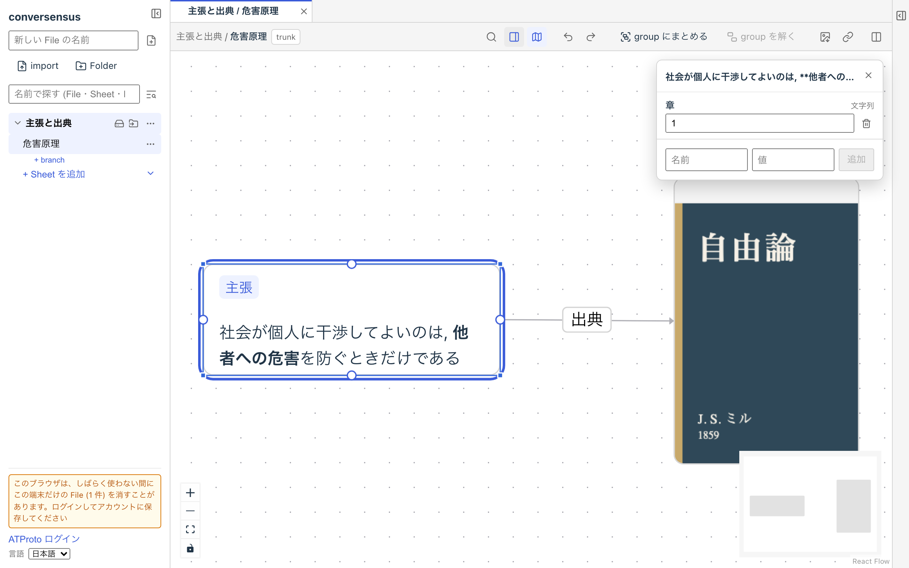

# conversensus って何

conversensus は, グラフ (graph) を用いて, 考え, 書き/描き, 対話するための道具です.

ここで「グラフ」とは, 箱 (node) を線 (edge) で接続した網 (network) 状の図形のことです.

グラフを数学の言葉で抽象的に表現することもできますが, 私たちはもっと具体的で,  豊富な内容を持たせることができる Labelled Property Graph (ラベル付き属性グラフ, ここでは LPG と略します) という種類のグラフを扱います.

つまり, node や edge にはラベル (label) と複数の属性 (property) を付けることができます (必須ではありません). LPG としてはラベルはただのラベルで, その意味は決まっておらず, 後から変えることもできます. ただし, 特定の template や拡張機能では, ラベルの意味を決め, 場合によっては変更できないようにしています (「グラフのカタ」で紹介する Toulmin model がその例です).

また, node はさまざまな内容 (contents) を持つことができ, edge には方向性がある (directed) ものとします. それ以外の決まりはありません.

<figure>
	
	<figcaption>単純なグラフ</figcaption>
</figure>

conversensus の LPG もある種の言語であるとすると, 「何かと何かの間の関係」を自然言語よりも明確に表現しやすい言語であると考えることができます.

また, LPG のラベルや内容には自然言語を使うこともできますから (実際, 私たちはそのような使われ方が多いだろうと想定しています), conversensus は自然言語を内部に埋め込んだ拡張言語であるとか, 自然言語による表現に関する表現としての高次 (meta) 言語であると考えることもできます.

conversensus は, そのような言語 (グラフ言語と呼びましょうか) で物事を考えたり, それを表現したり, それを使って対話するための道具です.

conversensus は, 何百万人もの不特定多数に対して何かを発信するようなものではありません.

数百人から数千人程度の参加者から成る共同体の内部, あるいはそのような共同体の間での意思疎通に役立つようなものになることを目指しています. もちろん, ひとりで使う, 数人で使うのも充分「あり」です.

この文章は, conversensus をまだ使ったことがない人に向けて, conversensus を一通り使えるようになるための情報を提供するものです.
